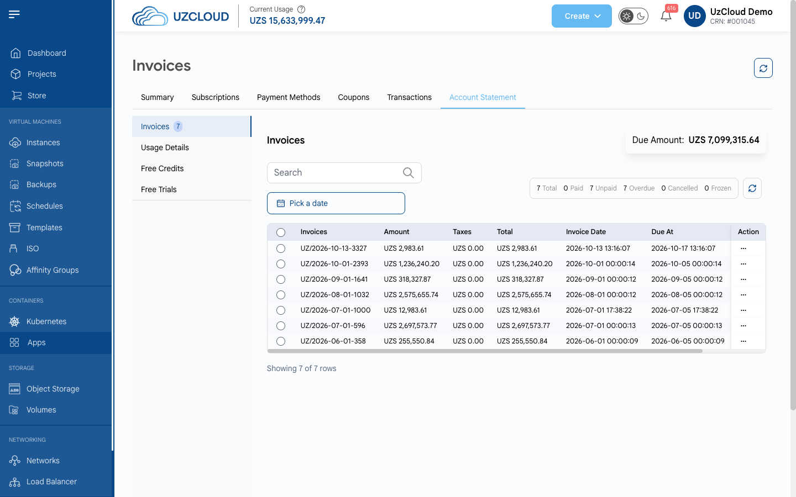

# Account Statement

## Account Statement

The **Account Statement** tab contains the financial documents of your account. It has the following sections:

- **Invoices** — the invoices for the services you used.
- **Usage Details** — a breakdown of resource consumption.
- **Free Credits** — the free credits granted to your account.
- **Free Trials** — the trial services.

The **Invoices** section shows the **Due Amount** and the number of invoices by status: **Paid**, **Unpaid**, **Overdue**, **Cancelled** and **Frozen**. For each invoice, the table shows the number, amount, taxes, total, invoice date, due date, payment date and status. Use **Pick a date** to filter invoices by period, and the menu (three dots) in the **Action** column to see the actions for an invoice.

### Conclusion

The **Account Statement** tab helps you keep track of your invoices, usage and credits.
