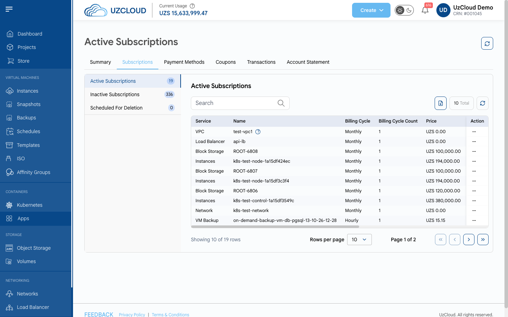

# Subscriptions

## Subscriptions

The **Subscriptions** tab lists all your paid services. Every resource you create (instance, disk, network, load balancer, backup and so on) is a subscription. Subscriptions are grouped into three lists:

- **Active Subscriptions** — services that are running and being billed.
- **Inactive Subscriptions** — services that have been canceled or deleted. They are not billed and cannot be reactivated.
- **Scheduled For Deletion** — services that are marked for termination and will be removed soon.

For each subscription, the table shows the service type, name, billing cycle and number of cycles, price, quantity, total usage (with and without tax), creation date and next invoice date. The menu (three dots) in the **Action** column opens the actions for the subscription. To export the list, click the download icon above the table.

### Conclusion

The **Subscriptions** tab helps you see which services you are paying for and when the next invoice will be issued.
