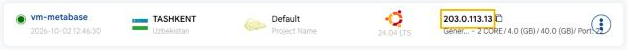

# Connect With SSH

## Connect with SSH in UzCloud

You can manage your instance using a terminal and SSH. This allows you to connect securely and perform administrative tasks remotely. You can either use an SSH client or connect directly via your terminal. This guide provides step-by-step instructions to connect to your cloud instance using an SSH client or terminal for secure remote access.

---

### Connecting to Your Instance via SSH

Before connecting to your instance, ensure you have the following information:

- **IP Address**: shown on the instance card and on the Virtual Machine Overview page (**Public IP**).

- **Default Username**: Depending on the operating system (`root`, `ubuntu`, `ec2-user`).

- **Authentication Method**:

  - **SSH Key (recommended)** — Ensure you have access to your private key file.
  - **Password** — shown in the **Provisioning Password** field on the Virtual Machine Overview page if you do not use an SSH key.



### Instance Information

- The **IP address** of your instance is displayed on the instance card. Click the copy icon next to it to copy it.
- Click the instance name to open the **Virtual Machine Overview** page, which shows the public IP, SSH port, username and password.


### Connecting to Your Instance

- Open a terminal:

  - **On Windows**: Use Command Prompt, PowerShell, or Git Bash.
  - **On macOS or Linux**: Use the built-in terminal.

- Use the appropriate SSH command to connect:

  - **If you are using an SSH Key**:

    ```bash
    ssh -i /path/to/your/private/key [username]@[ip_address]
    ```

  - **If you are using a password**:

    ```bash
    ssh [username]@[ip_address]
    ```

- Enter your password if prompted. **With a password**:

  ```bash
  ssh root@192.168.1.1
  ```

### Conclusion

By following this guide, you can securely connect to your cloud instance using SSH. Whether you use an SSH key or a password, SSH provides a reliable and secure method for remote access and management. For further assistance, refer to the UzCloud documentation or reach out to support.

> [!TIP]
> **See also:**
>
> - **[Connect With RDP](connect-with-rdp.md)**
> - **[Console Access](console-access.md)**
> - **[SSH Key](vm-settings/ssh-keys.md)**
