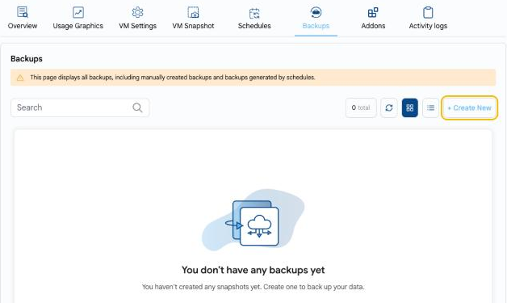

# Instance Backups

## Instance Backup in UzCloud

**Backups** create copies of your instance's data to protect it against accidental deletions, software failures, or security threats.

- On the **Virtual Machine Overview** page, open the **Backups** tab. It shows all backups of the VM, including manually created backups and backups generated by schedules.
- Click **+ Create New** to create a backup.
- To create backups automatically on a schedule, use the **Schedules** tab.

> [!TIP]
> **See also:**
>
> - **[Compute Instance](compute-instance.md)**
> - **[Instance Overview](instance-overview.md)**
> - **[Create Backups](../backups/create-backups.md)**
