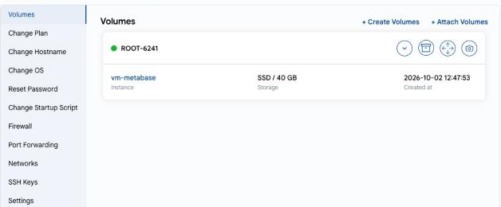

# Block Storage

## Block Storage Overview

Block Storage allows you to attach additional volumes to your virtual machine. Volumes act as independent, scalable disks for application data, backups, or other files, and can be detached and re-attached to other instances without data loss.

---

- On the **Virtual Machine Overview** page, open the **VM Settings** tab and select **Volumes**. The list shows the volumes of the instance, their storage type and size.
- Click **+ Create Volumes** to create a new volume for this instance, or **+ Attach Volumes** to attach an existing one.
- Use the icons on the volume card:
  - the arrow — show the snapshots of the volume;
  - **Create Template** — create a template from the volume;
  - **Resize Volumes** — change the size of the volume;
  - **Create Snapshot** — take a snapshot of the current state of the volume.

---

### Conclusion

Block Storage provides a reliable and modular way to manage your data independently of your virtual machines. Take snapshots regularly to protect critical data.

> [!TIP]
> **See also:**
>
> - **[Create Volume](../../volumes/create-volume.md)**
> - **[Volume Snapshot](../../volume-snapshots/create-volume-snapshot.md)**
> - **[VM Snapshot](../../vm-snapshots/create-instance-snapshot.md)**
