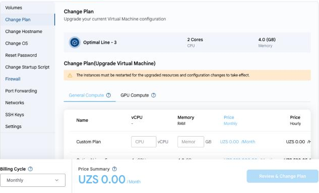

# Change Plan

## Change VM Plan

You can upgrade the resources of your VM — the number of vCPUs and the amount of memory — when your workload grows.

---

- On the **VM Settings** tab, select **Change Plan**. The current plan is shown at the top.
- Select a new plan on the **General Compute** or **GPU Compute** tab, or set your own configuration in the **Custom Plan** row. Only plans larger than the current one are available.

> [!WARNING]
> Downgrading is not supported. The instance must be restarted for the upgraded resources and configuration changes to take effect.

- Choose the **Billing Cycle** at the bottom of the page, check the **Price Summary** and click **Review & Change Plan**.

---

### Conclusion

Changing the plan lets you scale the VM resources when your workload grows. Plan the change for a time when a restart will not affect your users.
