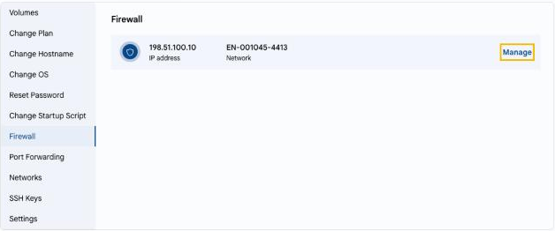

# Firewall

## Firewall Configuration

Firewall rules define which incoming traffic is allowed to reach your virtual machine: from which IP addresses, to which ports, and over which protocols. For example, you can allow only SSH (port 22) and web traffic (ports 80/443).

---

- On the **VM Settings** tab, select **Firewall**. The list shows the public IP addresses of the VM and their networks.
- Click **Manage** next to the IP address. The public IP address page opens on the **Firewall** tab, where you can add and remove rules.

---

### Conclusion

Proper firewall configuration minimizes the attack surface. Regularly review your rules and open only the ports you need.

> [!TIP]
> **See also:**
>
> - **[Public IP Address](../../networks/public-ip-address.md)**
