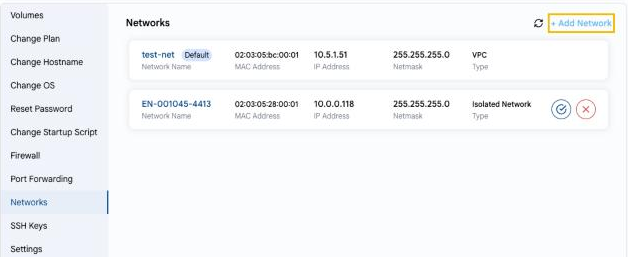

# Networks

## Network Configuration

This setting shows the network interfaces of your VM and lets you connect it to additional networks.

---

- On the **VM Settings** tab, select **Networks**. For each network, the name, MAC address, IP address, netmask and type are shown. The default network is marked **Default**.
- Click **+ Add Network** to connect the VM to another network.
- Use the icons on the network card to **Make This Network as Default** or **Remove Network**.

---

### Conclusion

Managing networks lets you combine internal communication and public access for your VM.

> [!TIP]
> - **[Create VPC Networks](../../networks/vpc-network/create-vpc-network.md)**
> - **[Create Public Networks](../../networks/public-network/create-public-network.md)**
