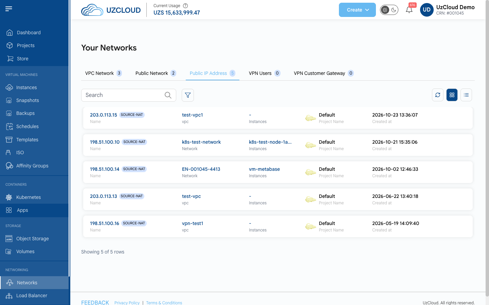
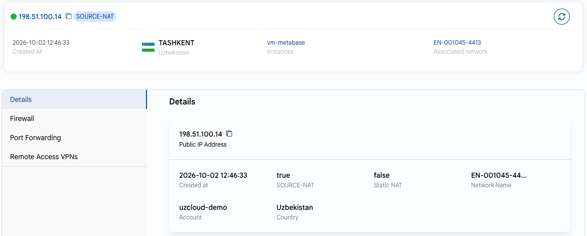
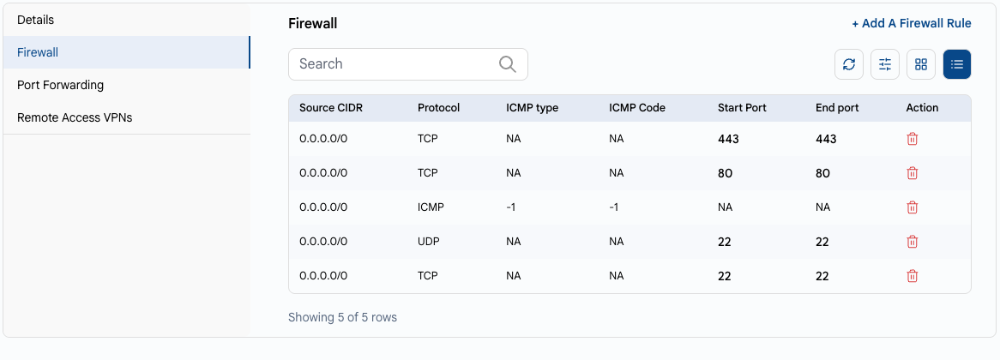
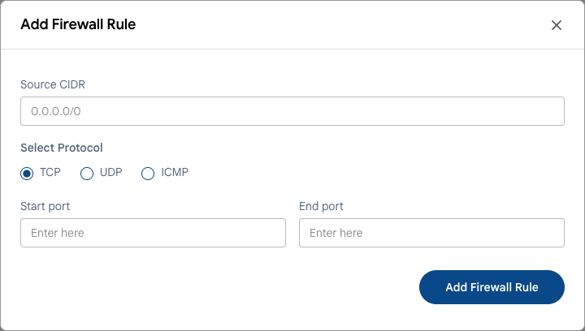
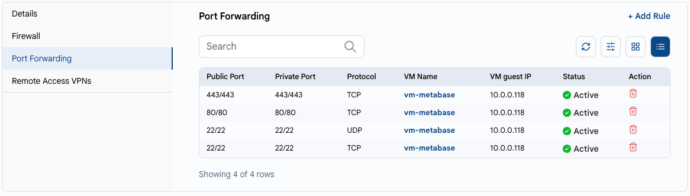
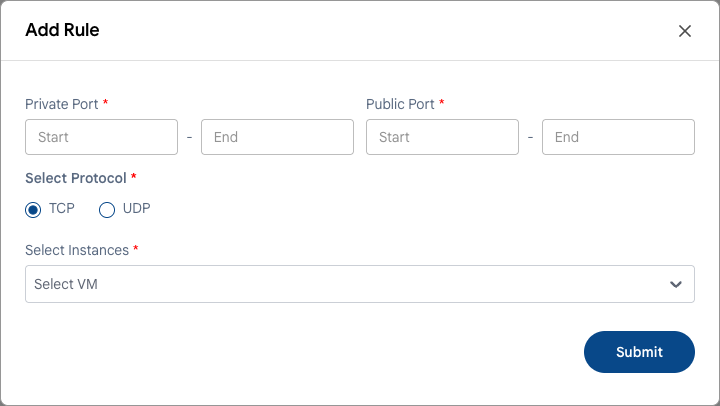
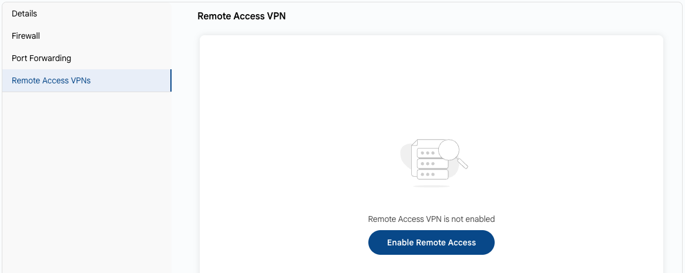

# Public IP Address

## Public IP Address

A **public IP address** in UzCloud is an internet-facing address that makes your cloud resources reachable from outside. For each address, you can configure firewall rules, port forwarding and remote access VPN.

---

### View Public IPs

- In the left-hand menu, under **NETWORKING**, click **Networks**, then open the **Public IP Address** tab. It lists your addresses with their network or VPC, instances, project and creation date. The **SOURCE-NAT** label marks the address that a network or VPC uses for outgoing traffic.

### Public IP Details

- Click an address to open its page. The card shows the creation date, location, instances and associated network. The **Details** tab shows the IP address, creation date, whether it is the **SOURCE-NAT** or **Static NAT** address, the network name, the account and the country.

### Firewall Rules

Firewall rules define which inbound traffic is allowed to reach the address.

- Open the **Firewall** tab. It lists the rules: source CIDR, protocol, ICMP type and code, and port range. To delete a rule, click the delete icon in its row.
- Click **+ Add A Firewall Rule**.

- Enter the **Source CIDR** (for example, `0.0.0.0/0` for any address), select the protocol (**TCP**, **UDP** or **ICMP**), enter the **Start port** and **End port** and click **Add Firewall Rule**.

### Port Forwarding Rules

Port forwarding sends traffic arriving at a public port to a port on a VM in the network.

- Open the **Port Forwarding** tab. It lists the rules: public and private ports, protocol, VM name, VM guest IP and status.
- Click **+ Add Rule**.

- **Private Port** — the port range (start and end) on the VM.
- **Public Port** — the port range (start and end) on the public IP address.
- **Select Protocol** — **TCP** or **UDP**.
- **Select Instances** — the VM that will receive the traffic.
- Click **Submit**.

> [!NOTE]
> For a port to be reachable from the internet, a firewall rule for it is also required.

### Remote Access VPN

- Open the **Remote Access VPNs** tab. To get secure remote access to the private network, click **Enable Remote Access**. Then add users on the **[VPN Users](vpn-users.md)** tab of the **Networks** page.

---

### Conclusion

By following this guide, you can manage public IP addresses in UzCloud: view their details, apply firewall rules, configure port forwarding and enable VPN access.
