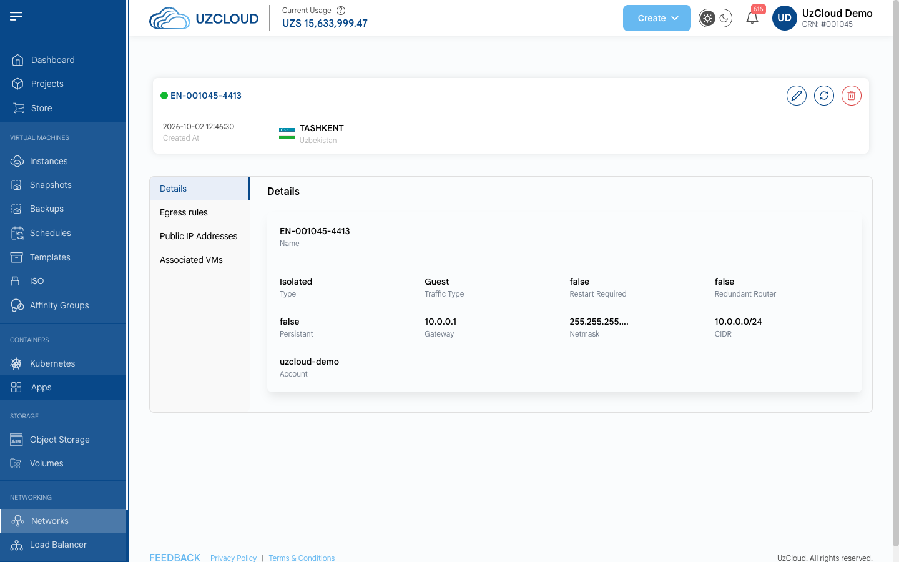
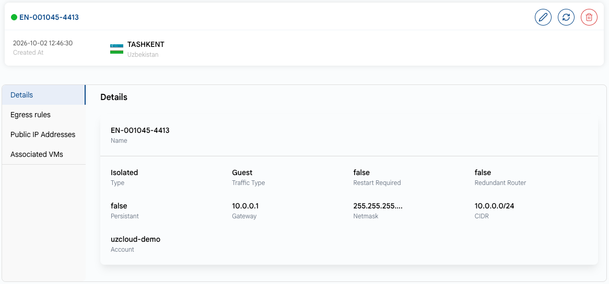

# Network Overview

## Public Network Overview

To open a public network, click its name on the **Public Network** tab of the **Networks** page. The network page shows its creation date and location. The action buttons in the upper-right corner let you edit the network, refresh the data and delete the network.

### Details

The **Details** tab shows the main network parameters.

- **Name** — the network name.
- **Type** — the network type (**Isolated**).
- **Traffic Type** — the traffic type (**Guest** — VM traffic).
- **Restart Required** — whether the network needs to be restarted to apply changes.
- **Redundant Router** — whether a redundant (backup) virtual router is used.
- **Persistant** — whether the network is kept active even without running VMs.
- **Gateway**, **Netmask** and **CIDR** — the network gateway, mask and address range.
- **Account** — the account that owns the network.

### Network Tabs

- **[Egress rules](egress-rules.md)** — the rules for outbound traffic.
- **[Public IP Addresses](public-ip-addresses.md)** — the public IP addresses of the network.
- **[Associated VMs](associated-vms.md)** — the VMs connected to the network.

### Conclusion

The network page provides key details about the network configuration: its type, gateway, netmask and CIDR, as well as access to egress rules and IP addresses.

> [!TIP]
> **See also:**
>
> - **[Create Public Network](create-public-network.md)**
> - **[Public IP Address](public-ip-addresses.md)**
