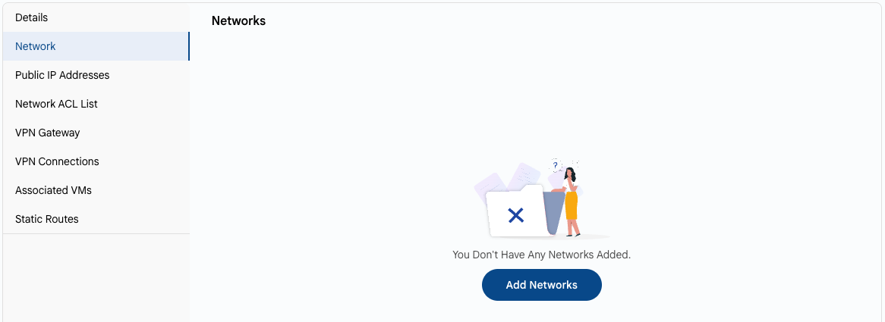
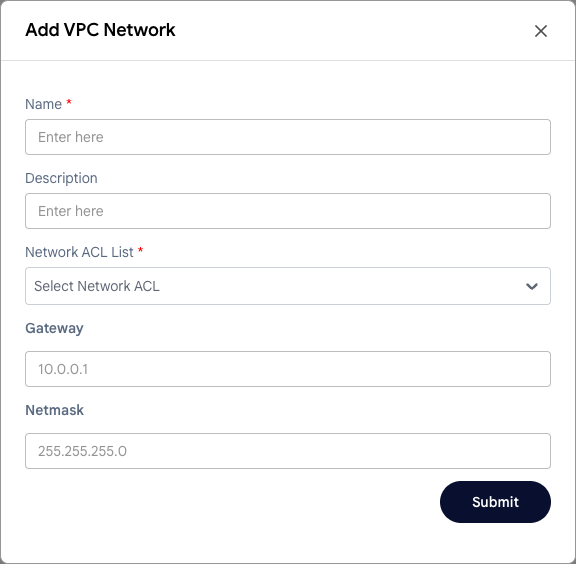

# Add Network

## Add VPC Network

The **Network** tab lists the networks (tiers) created inside the VPC. VMs connect to these networks, and each network can have its own ACL.

- On the VPC page, open the **Network** tab and click **Add Networks**.

- Fill in the **Add VPC Network** form:
  - **Name** — the network name.
  - **Description** — a summary of the network's purpose.
  - **Network ACL List** — the ACL that controls inbound and outbound traffic of the network (for example, `default_allow` or `default_deny`).
  - **Gateway** — the network gateway (for example, `10.0.0.1`). It must be inside the VPC address space.
  - **Netmask** — the network mask (for example, `255.255.255.0`).
- Click **Submit**.

### Conclusion

Adding networks to a VPC lets you split it into subnets with their own gateways and ACLs for better traffic control and organization.

> [!TIP]
> **See also:**
>
> - **[VPC Network Overview](network-overview.md)**
> - **[Network ACL List](network-acl-list.md)**
> - **[VPN Gateway](vpn-gateway.md)**
> - **[VPN Connections](vpn-connections.md)**
