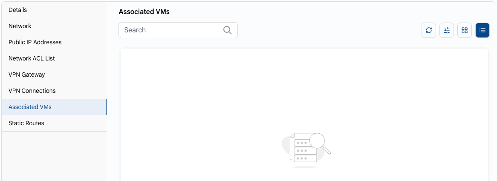

# Associated VMs

## Associated VMs

The **Associated VMs** tab on the VPC page lists the VMs connected to the VPC networks. Use the search and filters to find the right VM.

### Conclusion

The **Associated VMs** tab gives a clear view of all VMs linked to the VPC, helping you monitor and manage connected resources.
