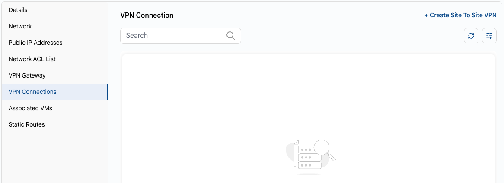
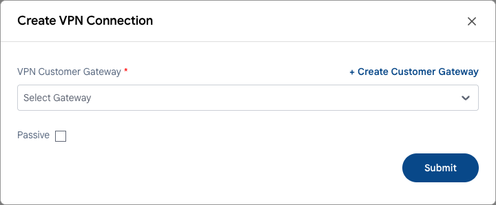

# VPN Connections

## VPN Connections

A site-to-site VPN connection links your VPC with a remote network through a VPN customer gateway.

- On the VPC page, open the **VPN Connections** tab. It lists the VPN connections of the VPC.
- Click **+ Create Site To Site VPN**.

- In the **Create VPN Connection** window, select the **VPN Customer Gateway** or create a new one with **+ Create Customer Gateway**.
- Select **Passive** if the connection should wait for the remote side to initiate it.
- Click **Submit**.

### Conclusion

The **VPN Connections** tab lets you set up and manage secure site-to-site VPNs between your VPC and external networks.

> [!TIP]
> **See also:**
>
> - **[VPC Network Overview](network-overview.md)**
> - **[Network ACL List](network-acl-list.md)**
> - **[VPN Gateway](vpn-gateway.md)**
> - **[VPN Customer Gateway](../vpn-customer-gateway.md)**
