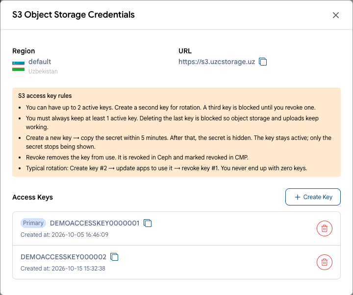

# Connecting over S3

UzCloud Object Storage is compatible with the Amazon S3 API: you can work with it from the console and from any S3 client or SDK. This article lists the parameters that every client needs.

## Connection Parameters

| Parameter | Value |
|---|---|
| Endpoint | `https://s3.uzcstorage.uz` |
| Region | `default` |
| Addressing style | path-style: `https://s3.uzcstorage.uz/<bucket>/<object>` |
| Access Key / Secret Key | the keys of your object store |

> [!IMPORTANT]
> Use the bucket name exactly as it is shown in the console, for example `demo-store-001045`.

## Access Keys

1. Open **Object Storage** in the console and click the name of your object store.
2. Click **Credentials**. The Access Key is shown in the **Access Keys** list.
3. The Secret Key is shown only within 5 minutes after you click **Create Key**. Copy it right away and store it in a password manager. If you lost the secret, create a new key and revoke the old one.

See **[Manage Object Storage](manage-object-storage.md#view-credentials)**.

## Client Settings

In addition to the endpoint, region and keys, check two settings in your tool or SDK:

- **Path-style addressing** must be enabled. The option is called differently in different clients: `addressing_style = path`, `forcePathStyle`, `use_path_style_endpoint`, `UsePathStyle`, `force_path_style`.
- **Checksums** — `when_required`. New versions of AWS CLI and AWS SDKs add checksum headers to every request by default; this setting keeps them only where the S3 API requires them.

Ready-made settings for popular clients:

- Command line: **[AWS CLI](tools/aws-cli.md)**, **[s3cmd](tools/s3cmd.md)**, **[rclone](tools/rclone.md)**, **[s3fs](tools/s3fs.md)**.
- File managers: **[Cyberduck](tools/cyberduck.md)**, **[S3 Browser](tools/s3-browser.md)**, **[S3 Explorer](tools/s3-explorer.md)**.
- Programming languages: **[Python](sdk/python.md)**, **[JavaScript](sdk/javascript.md)**, **[PHP](sdk/php.md)**, **[Go](sdk/go.md)**.

> [!TIP]
> Any other library or application that supports a custom S3 endpoint also works, for example the AWS SDKs for Java and .NET, MinIO clients, or backup software with S3 support.
