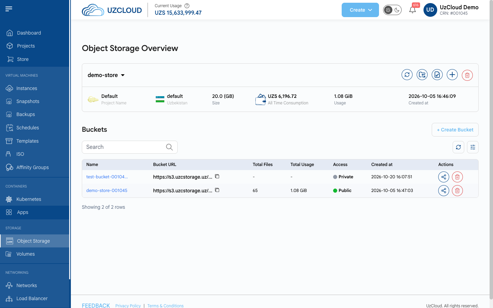
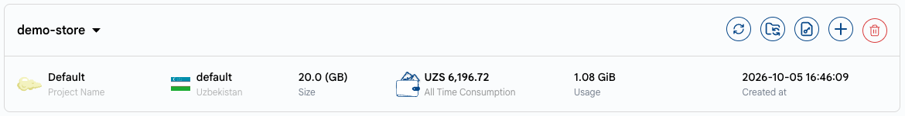
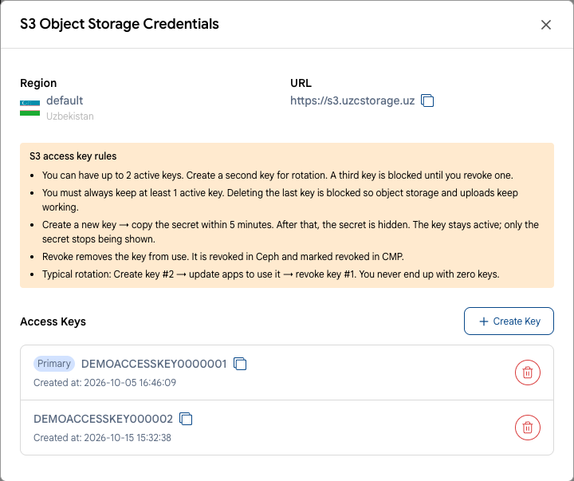
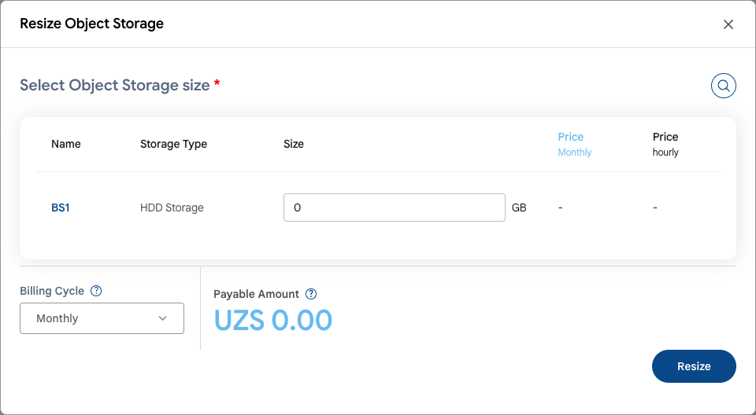
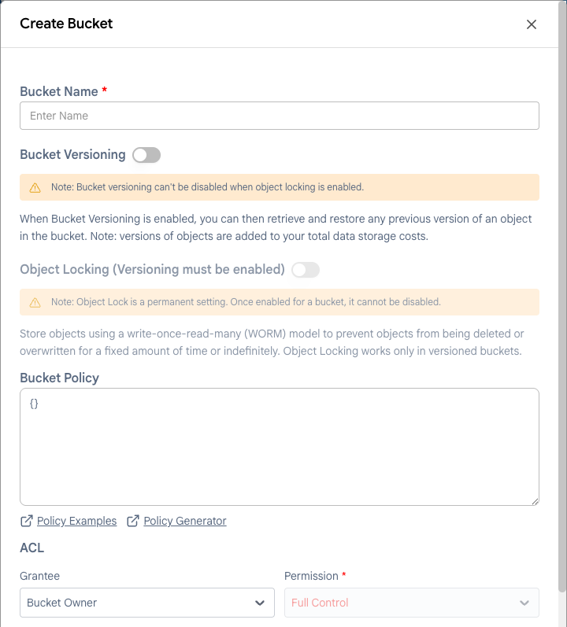
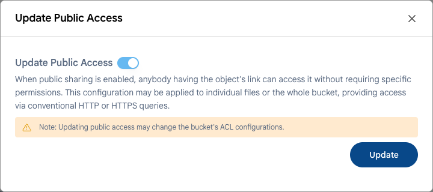
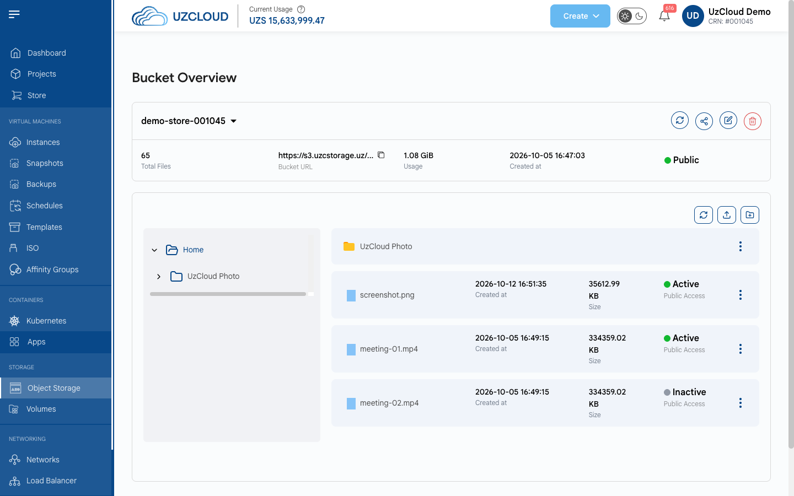
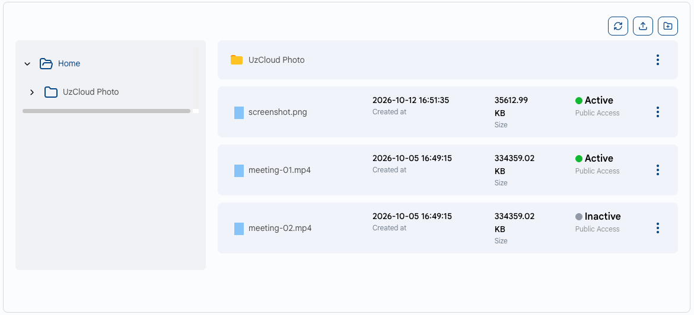

# Manage Object Storage

## Managing Object Storage

To open an object store, click its name on the **Object Storage** page. The **Object Storage Overview** page shows the store details and its buckets.

### Action Buttons

The store card shows the project, location, size, all-time consumption, usage and creation date. The action buttons are on the right.

- **Refresh** — reloads the store status and data.
- **Sync Buckets** — synchronizes the list of buckets with the storage.
- **Credentials** — shows the S3 endpoint and access keys.
- **Upgrade/Downgrade Store** — changes the store size.
- **Delete Object Storage** — permanently deletes the store.

### View Credentials

- Click **Credentials**. The **S3 Object Storage Credentials** window shows the **Region**, the S3 endpoint **URL** (`https://s3.uzcstorage.uz`) and your **Access Keys**.

- Access key rules:
  - You can have up to 2 active keys. Create a second key for rotation; a third key is blocked until you revoke one.
  - At least 1 active key must always remain. Deleting the last key is blocked.
  - After you click **Create Key**, copy the secret key within 5 minutes. After that, the secret is hidden; the key stays active.
  - Revoking a key removes it from use.
- Typical rotation: create key #2 → update your applications to use it → revoke key #1.

### Resize Object Storage

- Click **Upgrade/Downgrade Store**. In the **Resize Object Storage** window, enter the new size in GB.
- Choose the **Billing Cycle**, check the **Payable Amount** and click **Resize**.

### Create a Bucket

- In the **Buckets** section, click **+ Create Bucket**.
- Enter a **Bucket Name**.
- Turn on **Bucket Versioning** if needed: you can then retrieve and restore any previous version of an object in the bucket.
- Turn on **Object Locking** to store objects using a write-once-read-many (WORM) model. Objects then cannot be deleted or overwritten for a fixed period or indefinitely.
- Optionally, set a **Bucket Policy** in JSON format (see **Policy Examples** and **Policy Generator**) and the **ACL** permissions.
- Click **Create**.

> [!NOTE]
> - Object Locking works only in versioned buckets.
> - Object Lock is a permanent setting: once enabled for a bucket, it cannot be disabled, and versioning can no longer be turned off.
> - Object versions are added to your total data storage costs.

### Bucket Public Access

- The buckets table shows the name, bucket URL, total files, total usage, access (**Public** or **Private**) and creation date.
- To change public access, click the share icon in the bucket row (or **Share Bucket** on the bucket page), turn **Update Public Access** on or off and click **Update**.

> [!WARNING]
> When public access is enabled, anyone with an object's link can access it without any permissions. Updating public access may change the bucket's ACL configuration.

### Bucket Overview

- Click a bucket name to open the **Bucket Overview** page. It shows the total files, bucket URL, usage, creation date and access type.
- The action buttons let you **Refresh** the data, **Share Bucket**, **Update Bucket** and delete the bucket.

- In the file manager, you can browse folders, **Upload Files** and **Create Folder**. The menu (three dots) next to each file opens the actions for it. Each file shows its creation date, size and public access status.

### Conclusion

By following this guide, you can manage your object storage: get access keys, resize the store, create buckets and control their access. For further assistance, refer to the UzCloud documentation or reach out to support.
