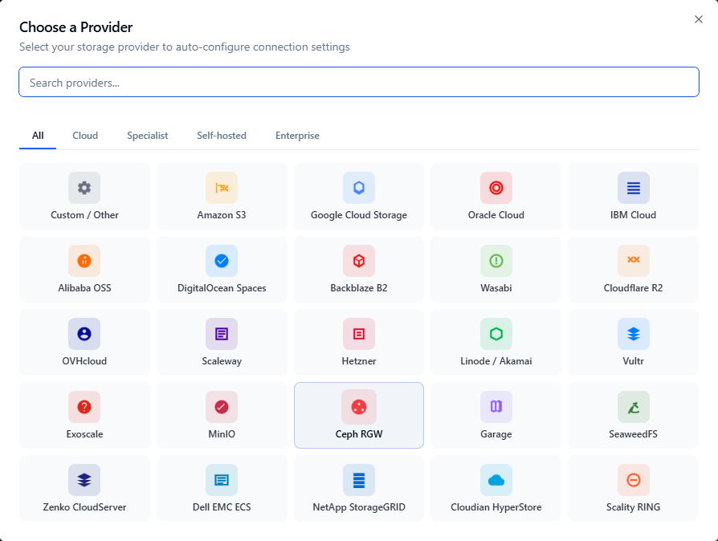
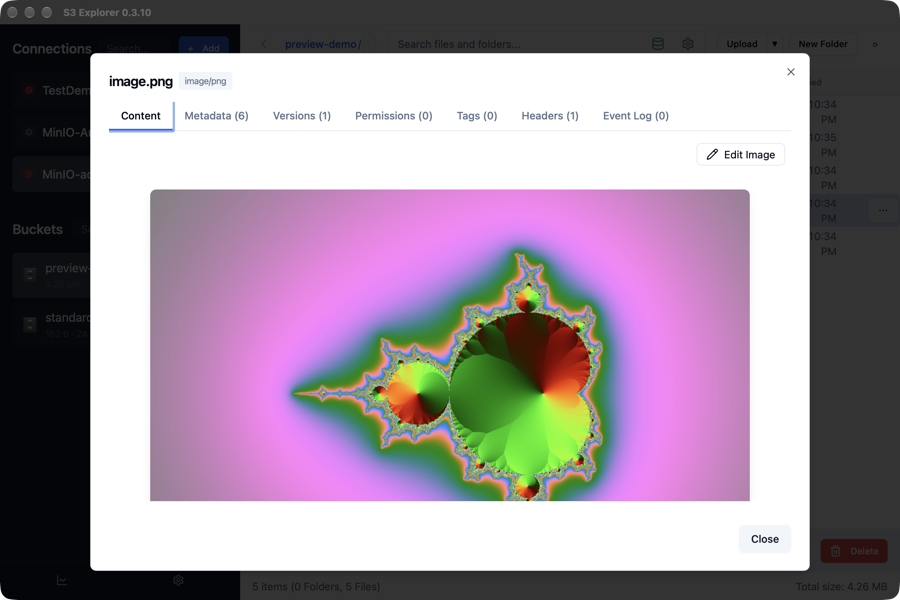

# S3 Explorer

**S3 Explorer** is a graphical S3 client for Windows, macOS and Linux. It lets you browse buckets, upload and download files, and preview images, video, audio and text. It is free for up to 5 connection profiles.

## Installation

Download S3 Explorer from [s3explorer.accessdevops.com](https://s3explorer.accessdevops.com/) and install it.

## Connect

1. Click **+ Add** next to **Connections**, then choose **Custom / Other**.

   

2. **Profile Name**: any name, for example `UzCloud`.
3. **Endpoint URL**: `https://s3.uzcstorage.uz`.
4. **Region**: `default`.
5. Enter the **Access Key** and **Secret Key**.
6. Select **Force path-style addressing**.
7. Click **Test Connection**, then **Save**. The list of your buckets opens.

> [!TIP]
> **See also:**
>
> - **[Connection Parameters](../connection.md)**
