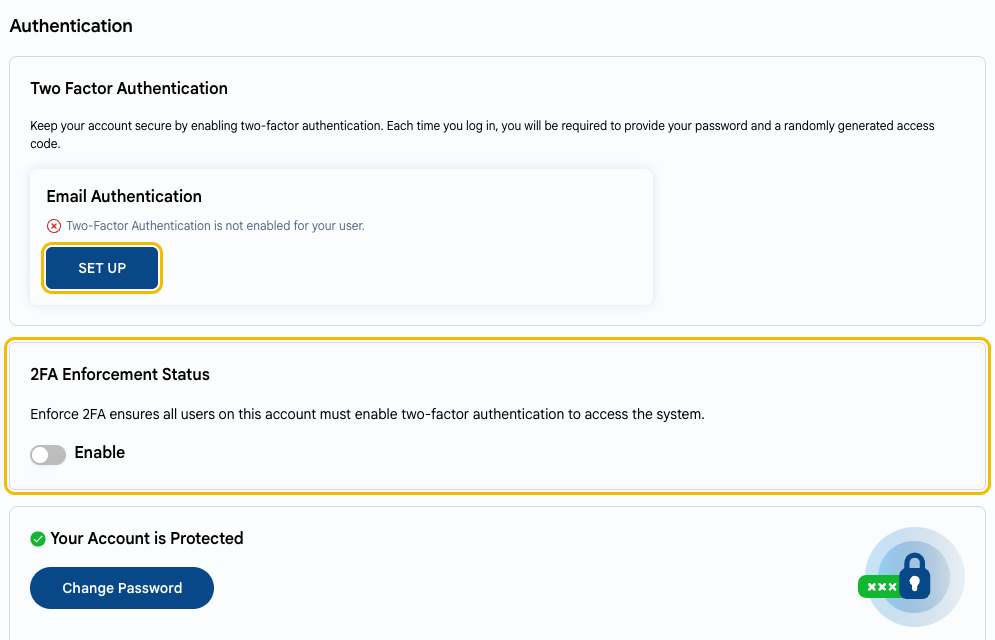
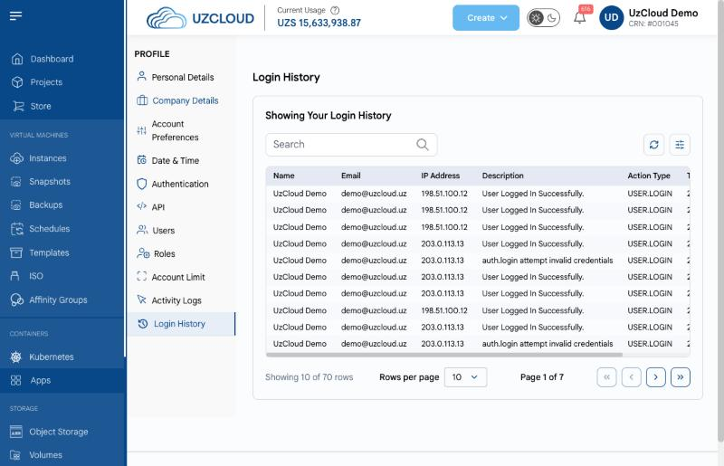

# Account Security

## Protect Your UzCloud Account

Whoever controls your UzCloud account controls all your VMs, disks and backups. Protect the account just as carefully as the servers.

---

### Enable Two-Factor Authentication

Two-factor authentication (2FA) protects your account even if your password leaks: at each sign-in, you also enter a one-time code sent to your email.

- Open **Profile → Authentication** and click **SET UP** in the **Email Authentication** block.
- If you are the account owner, turn on **2FA Enforcement Status**: then all users of the account must enable two-factor authentication to sign in.

See also **[Profile Setup](../getting-started/profile-setup.md#secure-your-account-with-two-factor-authentication)**.

### Use a Strong, Unique Password

Use a long password that you don't use for other services, and store it in a password manager. Change it immediately if you suspect a leak.

### Separate Users and Roles

- Do not share one account between employees. Add a separate user for each employee: **Profile → Users**.
- Give each user only the role they need. For example, an accountant needs billing access, not VM management.
- Remove users who no longer need access, for example, after an employee leaves.

See **[Profile Setup](../getting-started/profile-setup.md#add-a-new-user)**.

### Keep API Tokens and Access Keys Safe

- Do not store API tokens and S3 access keys in code repositories or send them in messengers.
- Give each application its own key, so that you can revoke it without affecting the others.
- Rotate keys regularly and immediately revoke a key that may have leaked. For object storage, see **[Manage Object Storage](../object-storage/manage-object-storage.md#view-credentials)**.
- Do not make object storage buckets public unless they host public files.

### Watch Account Activity

Review the **Activity Logs** and **Login History** in your profile regularly. Unknown logins or actions you did not perform are a reason to change your password and contact support.

---

### Conclusion

2FA, separate users with minimal roles and careful handling of keys protect your account and all the resources in it.

> [!TIP]
> **See also:**
>
> - **[Security Checklist](security-checklist.md)**
