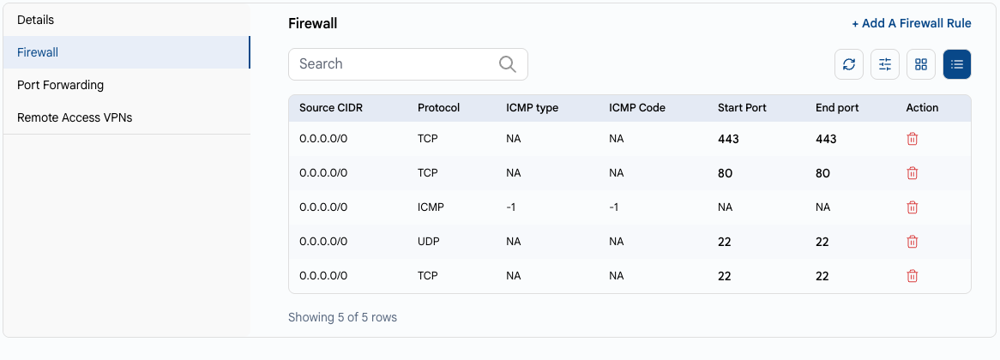
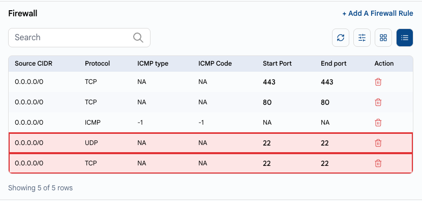
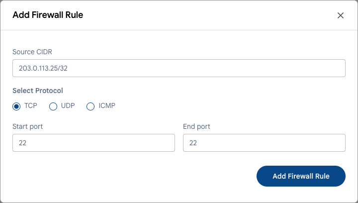

# Network Access

## Open Only What You Need

Every open port is a potential entry point. A database, admin panel or remote access port open to the whole internet is found by scanners within hours.

---

### Rule 1. Open Only the Required Ports

In UzCloud, inbound traffic to a public IP address is controlled by **firewall rules** in the console. A port is reachable from the internet only if there is a rule for it.

- Open the public IP address of the VM: **Networks → Public IP Address**, or the **Firewall** tab in the VM settings. See **[Public IP Address](../networks/public-ip-address.md)** and **[Firewall](../compute/vm-settings/firewall.md)**.
- Review the rules and delete the ones you don't need.
- Open web ports (80, 443) for everyone only if the VM serves a public website.



### Rule 2. Restrict Remote Access by IP

Do not open SSH (22) and RDP (3389) for `0.0.0.0/0`. In the example below, SSH is open to the whole internet — this is exactly what bots look for:



Delete such rules and add a rule only for your addresses. In the **Source CIDR** field, specify only the addresses you connect from, for example, your office IP with the `/32` mask.



If you connect from changing addresses, use **remote access VPN**: enable it on the public IP address, add VPN users and allow SSH/RDP only inside the private network. See **[Public IP Address](../networks/public-ip-address.md#remote-access-vpn)** and **[VPN Users](../networks/vpn-users.md)**.

### Rule 3. Never Expose Databases and Internal Services

Databases (MySQL 3306, PostgreSQL 5432, MongoDB 27017, Redis 6379), admin panels and monitoring should not be reachable from the internet.

- Place them in a private network or VPC without public port forwarding. See **[VPC Network](../networks/vpc-network/create-vpc-network.md)**.
- Connect to them from application servers in the same network, or through VPN.
- To publish a web application, use a **[Load Balancer](../load-balancer/load-balancer.md)** instead of opening the application ports of every VM.

### Rule 4. Check What Listens Inside the VM

Even if a port is closed in the console, it's better not to run services you don't need. Show the listening services:

```bash
sudo ss -tulpn
```

Stop and disable everything you don't use or don't recognize (old panels, test services):

```bash
sudo systemctl disable --now <service>
```

As an additional layer, enable the OS firewall: `ufw` on Ubuntu and Debian, `firewalld` on Rocky Linux, AlmaLinux and RHEL.

> [!WARNING]
> Before you enable `ufw` or `firewalld`, allow SSH in it (`sudo ufw allow 22/tcp`). Otherwise, you will lose access. If this happens, use the **[web console](../compute/console-access.md)**.

### Windows Server and RDP

- Allow RDP only from your IP addresses or through VPN.
- Use strong passwords and enable Network Level Authentication (NLA, enabled by default on current Windows Server versions).
- Install Windows updates regularly — see **[Update the Operating System](update-os.md)**.

---

### Conclusion

A minimal set of open ports and access by IP or VPN greatly reduces the attack surface of your VMs.

> [!TIP]
> **See also:**
>
> - **[Security Checklist](security-checklist.md)**
> - **[SSH Hardening](ssh-hardening.md)**
