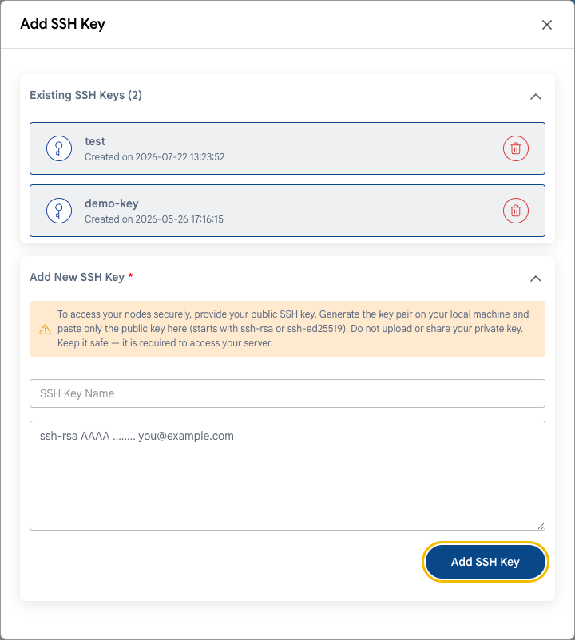

# SSH Hardening

## Secure SSH Access to Linux VMs

Password guessing over SSH is the most common attack on servers with a public IP address. Bots scan the internet and try thousands of passwords per hour. The best protection is to sign in with SSH keys only.

---

### Step 1. Add an SSH Key

- When you create a VM, add your public SSH key in the **Add SSH Key To Your Instance** block. See **[Compute Instance](../compute/compute-instance.md)**.
- For an existing VM, you can manage keys on the **SSH Keys** tab of the VM settings. See **[SSH Keys](../compute/vm-settings/ssh-keys.md)**.



If you don't have a key yet, create one on your computer:

```bash
ssh-keygen -t ed25519
```

The public key is saved to `~/.ssh/id_ed25519.pub`. Never share or upload the private key (`id_ed25519` without `.pub`).

### Step 2. Disable Password Login and Root Login

> [!WARNING]
> First make sure that you can sign in with the key. Keep the current SSH session open and check the login in a second terminal window. Otherwise, you may lose access to the server. If this happens, use the **[web console](../compute/console-access.md)**.

1. Create a user with sudo rights, if you sign in as root:

   ```bash
   adduser admin
   usermod -aG sudo admin    # Ubuntu and Debian
   usermod -aG wheel admin   # Rocky, AlmaLinux, RHEL
   ```

   Copy your key to this user (`~/.ssh/authorized_keys`) and check that you can sign in as this user.

2. Open the SSH server configuration:

   ```bash
   sudo nano /etc/ssh/sshd_config
   ```

3. Set the following parameters:

   ```text
   PasswordAuthentication no
   PermitRootLogin no
   ```

   On newer distributions, also check the files in `/etc/ssh/sshd_config.d/`: a setting there may override the main file.

4. Check the configuration and restart the SSH server:

   ```bash
   sudo sshd -t && sudo systemctl restart ssh    # Ubuntu and Debian
   sudo sshd -t && sudo systemctl restart sshd   # Rocky, AlmaLinux, RHEL
   ```

5. In a second terminal window, check that you can still sign in with the key.

### Step 3. Restrict Who Can Connect

Allow SSH only from your IP addresses or through VPN. See **[Network Access](network-access.md)**. Changing the port from 22 to a non-standard one reduces noise from bots in the logs, but it does not replace an IP restriction.

### Step 4. Block Password Guessing

Install **fail2ban**: it blocks IP addresses that repeatedly fail to sign in.

```bash
sudo apt install fail2ban                         # Ubuntu and Debian
sudo dnf install epel-release && sudo dnf install fail2ban   # Rocky, AlmaLinux
sudo systemctl enable --now fail2ban
```

The default settings protect SSH. Check the status with:

```bash
sudo fail2ban-client status sshd
```

---

### Conclusion

Key-only SSH login with IP restrictions protects your VM from the most common attacks. For Windows VMs, the same principles apply to RDP — see **[Network Access](network-access.md)**.

> [!TIP]
> **See also:**
>
> - **[Security Checklist](security-checklist.md)**
> - **[Connect With SSH](../compute/connect-with-ssh.md)**
