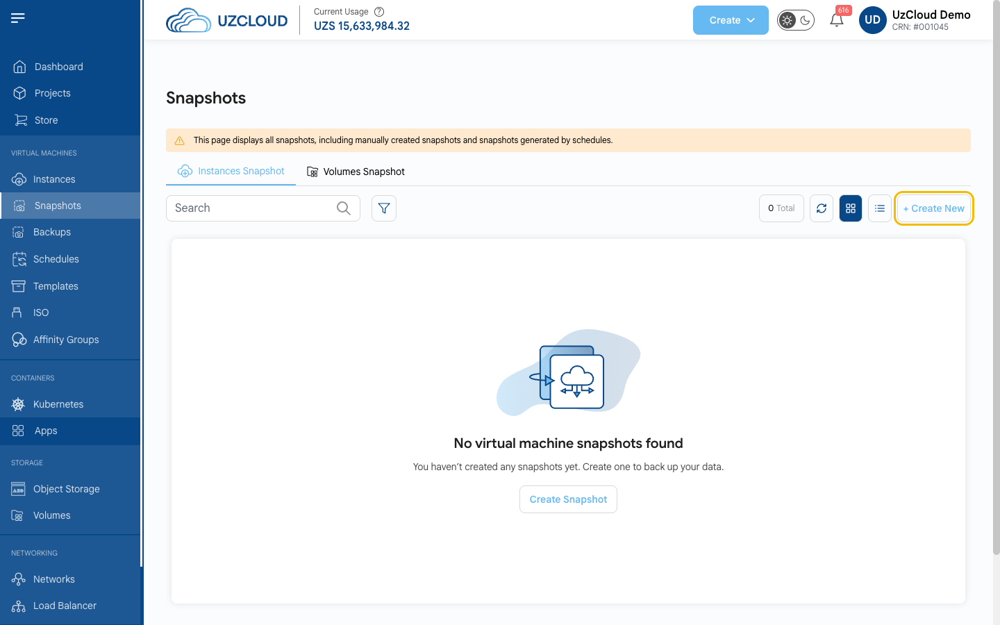

# Update the Operating System

## Keep Your Operating System Up to Date

Most successful attacks exploit vulnerabilities that already have a fix. Install updates regularly, and make sure your operating system still receives security patches from its vendor.

---

### Step 1. Make a Backup

Before any update, take a snapshot of the VM in the UzCloud console. See **[Create Instance Snapshot](../vm-snapshots/create-instance-snapshot.md)**.



> [!WARNING]
> A snapshot of a running database is not always consistent. Back up databases and important configuration files separately (for example, with `pg_dump` or `mysqldump`). A backup is only reliable once you have tested restoring it.

### Step 2. Install Updates

Connect to the VM over SSH or open the **[web console](../compute/console-access.md)**, then run the command for your distribution.

**Ubuntu and Debian:**

```bash
sudo apt update && sudo apt upgrade -y
```

**Rocky Linux, AlmaLinux, RHEL, Oracle Linux, CentOS Stream:**

```bash
sudo dnf update -y
```

**SUSE Linux Enterprise / openSUSE:**

```bash
sudo zypper refresh && sudo zypper patch
```

**Windows Server:** open **Settings → Windows Update** and click **Check for updates**, or run `sconfig` and select **Install updates**.

### Step 3. Reboot if Required

If the kernel or system libraries were updated, reboot the VM. **Until you reboot, the old kernel keeps running and the vulnerability is not fixed.**

Check whether a reboot is required:

```bash
# Ubuntu and Debian: the file exists if a reboot is required
ls /var/run/reboot-required

# Rocky Linux, AlmaLinux, RHEL, Oracle Linux
sudo dnf needs-restarting -r

# SUSE
sudo zypper needs-rebooting
```

Reboot:

```bash
sudo reboot
```

You can also reboot the VM with the **Reboot** button on the VM page in the console. After the reboot, check the running kernel version:

```bash
uname -r
```

### Step 4. Check That Your OS Is Still Supported

Find out your distribution and version:

```bash
cat /etc/os-release
```

Check the end-of-life date on the vendor's website. **The following versions no longer receive free security updates:**

- CentOS 7 and CentOS 8 (including CentOS Stream 8);
- Ubuntu 20.04 and earlier;
- Debian 11 and earlier;
- Windows Server 2012 R2 and earlier.

On these systems, `apt upgrade` or `dnf update` does not fix new vulnerabilities. What to do:

1. **Move to a supported version (recommended).** Create a new VM with a current OS (for example, Ubuntu 24.04 or 26.04, Debian 12 or 13, Rocky Linux 9 or AlmaLinux 9 — all of them are available in UzCloud), move your application, data and settings to it, and keep the old VM for a couple of weeks in case you need to roll back.
2. **If you cannot move yet**, subscribe to extended support from the vendor (for example, Ubuntu Pro), close the server from the internet and allow access only through VPN — see **[Network Access](network-access.md)**.

> [!NOTE]
> The same applies to applications. Old versions of PHP, Node.js, Python or databases (for example, PHP 7.x or PostgreSQL 11 and earlier) do not get fixes from the distribution repository, even if the OS itself is supported. Check application versions too.

### Step 5. Enable Automatic Security Updates

**Ubuntu and Debian:**

```bash
sudo apt install unattended-upgrades
sudo dpkg-reconfigure --priority=low unattended-upgrades
```

**Rocky Linux, AlmaLinux, RHEL, Oracle Linux:**

```bash
sudo dnf install dnf-automatic
sudo systemctl enable --now dnf-automatic-install.timer
```

Automatic updates install patches, but they do not reboot the server. Once a month, check that the updates were installed and reboot the VM at a convenient time.

---

### Conclusion

Regular updates and a supported OS close most known vulnerabilities. Combine them with **[SSH hardening](ssh-hardening.md)** and **[network restrictions](network-access.md)** to protect your VMs.

> [!TIP]
> **See also:**
>
> - **[Security Checklist](security-checklist.md)**
> - **[CVE-2026-98432: Linux kernel TCP vulnerability](vulnerabilities/cve-2026-98432.md)**
