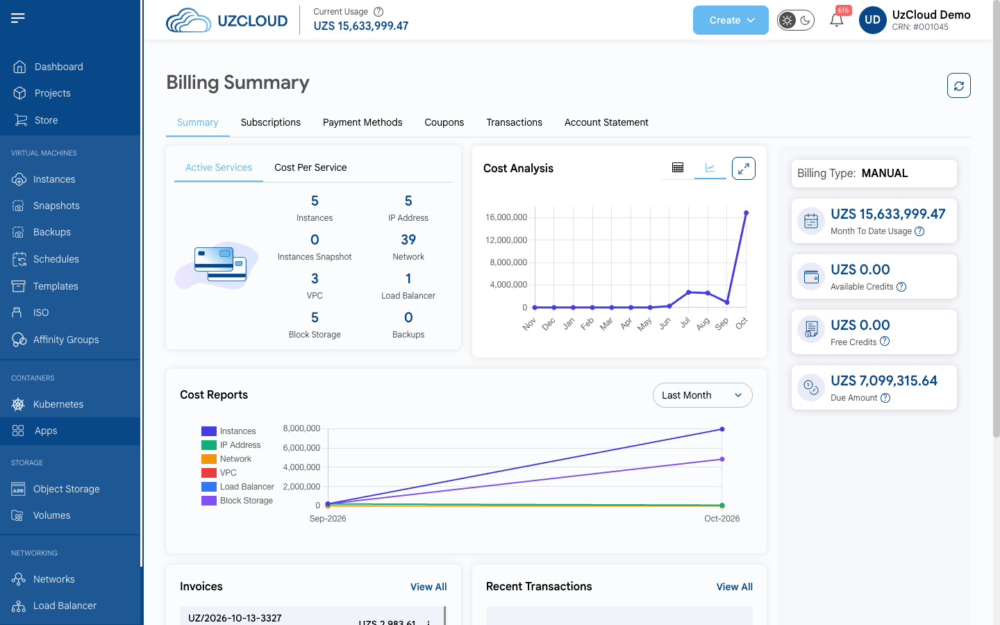
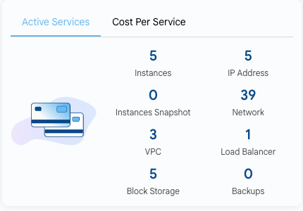
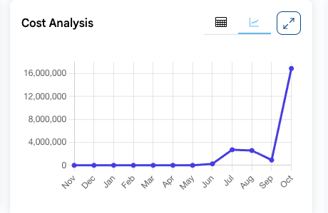
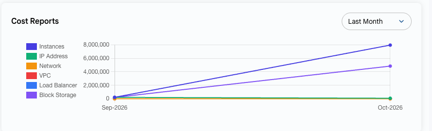
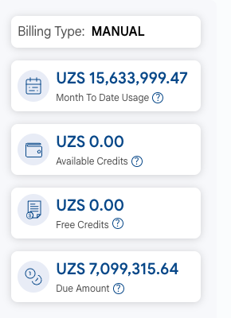
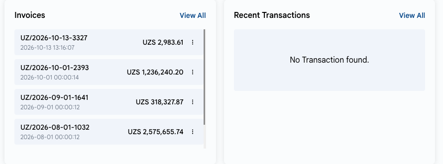

# Сводка по биллингу

## Руководство по сводке биллинга

Раздел **Billing** консоли UzCloud показывает ваши расходы, активные сервисы, счета и платежи. В нем есть вкладки **Summary**, **[Subscriptions](subscriptions.md)**, **[Transactions](transactions.md)** и **[Account Statement](account-statement.md)**.

- В левом меню нажмите **Billing** (рядом показан текущий баланс). Откроется страница **Billing Summary**.

### Активные сервисы

- На вкладке **Active Services** показано количество ваших ресурсов по типам: ВМ, IP-адреса, снимки ВМ, сети, VPC, балансировщики нагрузки, блочные хранилища и резервные копии.
- На вкладке **Cost Per Service** показаны расходы по типам сервисов.

### Анализ расходов

- График **Cost Analysis** показывает расходы по месяцам. Значки над графиком переключают вид (таблица или график) и разворачивают график на весь экран.

### Отчеты о расходах

- График **Cost Reports** показывает расходы по каждому типу ресурсов за выбранный период (например, **Last Month**).

### Тип биллинга и баланс

В правой части страницы:

- **Billing Type** — тип биллинга вашего аккаунта.
- **Month To Date Usage** — расход с начала месяца.
- **Available Credits** — доступные средства на счете.
- **Free Credits** — бесплатные (бонусные) средства.
- **Due Amount** — сумма к оплате.

### Счета и последние транзакции

- В разделе **Invoices** перечислены последние счета: номер, дата и сумма. Меню (три точки) рядом со счетом открывает действия с ним. Нажмите **View All**, чтобы открыть все счета на вкладке **Account Statement**.
- В разделе **Recent Transactions** перечислены последние платежи. Нажмите **View All**, чтобы открыть вкладку **Transactions**.

### Заключение

Страница **Billing Summary** дает общее представление о расходах и балансе и быстрый доступ к счетам и платежам.
