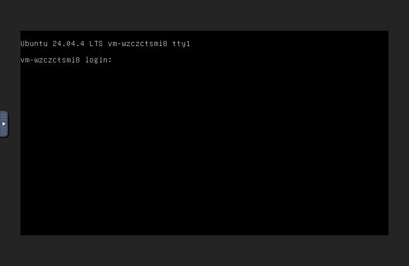
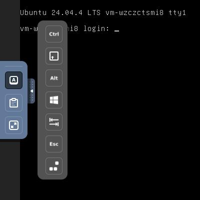
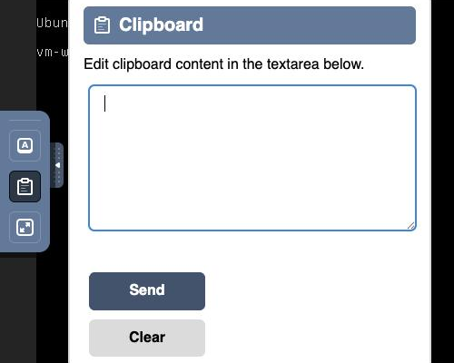

# Доступ к консоли

## Доступ к консоли виртуальных машин

Функция **Console Access** позволяет работать с виртуальной машиной (ВМ) прямо в браузере, как если бы вы находились рядом с ней. Это удобно для диагностики проблем при загрузке, настройки системы или доступа к ВМ, когда SSH или RDP недоступны.

- Нажмите на значок **Console Access** в быстрых действиях на карточке ВМ или на странице **Virtual Machine Overview**. Консоль откроется в новой вкладке браузера.

### Панель инструментов консоли

Чтобы открыть панель инструментов, нажмите на ярлычок у левого края окна консоли. На панели три кнопки:

- **Show extra keys** — открывает панель специальных клавиш:
  - **Toggle Ctrl**, **Toggle Shift**, **Toggle Alt** и **Toggle Windows** — нажимают и удерживают соответствующую клавишу в ВМ;
  - **Send Tab** и **Send Escape** — отправляют клавишу Tab или Esc;
  - **Send Ctrl-Alt-Del** — отправляет сочетание Ctrl+Alt+Delete.

- **Clipboard** — открывает поле для передачи текста в ВМ: вставьте текст в поле и нажмите **Send**. Кнопка **Clear** очищает поле.

- **Full screen** — разворачивает консоль на весь экран.

### Управление виртуальной машиной

Через консоль можно выполнять любые задачи, требующие прямого доступа к машине: устанавливать программы, менять настройки и диагностировать операционную систему — без внешних инструментов вроде SSH или RDP.

### Заключение

Функция **Console Access** — удобный способ работать с виртуальными машинами прямо в браузере. Если нужна помощь, изучите документацию UzCloud или обратитесь в поддержку.

> [!TIP]
> **См. также:**
>
> - **[Подключение по SSH](connect-with-ssh.md)**
> - **[Подключение по RDP](connect-with-rdp.md)**
