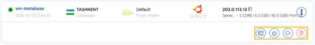
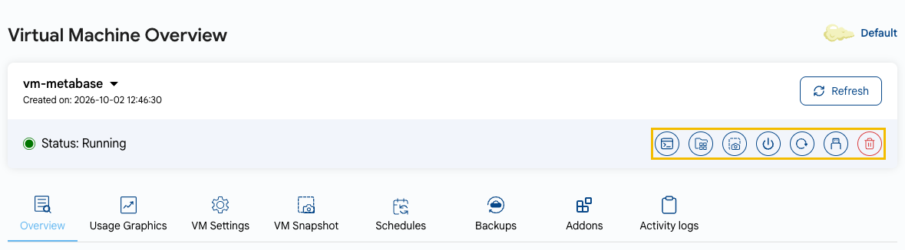
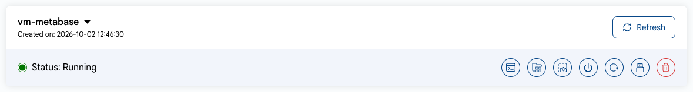
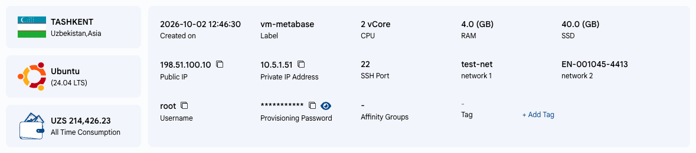
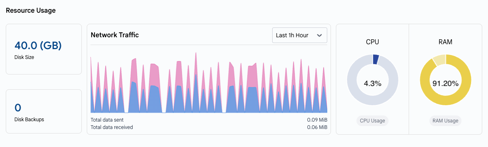

# Обзор виртуальной машины

## Обзор виртуальной машины в UzCloud

Страница **Virtual Machine Overview** содержит подробную сводку о виртуальной машине (ВМ) и быстрые действия для управления ею.

---

### Быстрые действия в списке ВМ

- На странице **Instances** нажмите на кнопку с тремя точками на карточке ВМ, чтобы открыть быстрые действия: доступ к консоли, остановка, перезагрузка и удаление.

### Кнопки действий

- Нажмите на имя ВМ, чтобы открыть страницу **Virtual Machine Overview**. Кнопки действий расположены справа в строке статуса.

- **Refresh** — обновляет статус ВМ и информацию на странице.
- **Console Access** — открывает веб-консоль для прямой работы с ВМ.
- **VM Volumes Snapshots** — показывает снимки томов ВМ и позволяет сделать новый.
- **VM Snapshot** — создает снимок всей ВМ.
- **Stop** — выключает виртуальную машину (если ВМ остановлена, кнопка запускает ее).
- **Reboot** — перезагружает ВМ.
- **Attach ISO To This Virtual Machine** — подключает к ВМ ISO-образ для установки или восстановления системы.
- **Delete** — безвозвратно удаляет ВМ.

Также на странице есть вкладки: **Overview**, **Usage Graphics**, **VM Settings**, **VM Snapshot**, **Schedules**, **Backups**, **Addons** и **Activity logs**.

### Информация о виртуальной машине

- **Имя ВМ** и **Created on** — имя виртуальной машины, дата и время ее создания. С помощью стрелки рядом с именем можно переключаться между ВМ.
- **Status** — текущее состояние ВМ (например, Running).

### Сведения о виртуальной машине

- **Расположение** — дата-центр, в котором находится ВМ.
- **Операционная система** — ОС, установленная на ВМ.
- **All Time Consumption** — стоимость потребления ВМ за все время с момента создания.
- **Label** — имя ВМ.
- **CPU**, **RAM** и **SSD** — количество vCore, объем памяти и размер диска.
- **Public IP** и **Private IP Address** — публичный и внутренний IP-адреса (их можно скопировать с помощью значка копирования).
- **SSH Port** — порт для подключения по SSH.
- **network 1**, **network 2**… — сети, к которым подключена ВМ.
- **Username** и **Provisioning Password** — учетные данные для входа по умолчанию. Чтобы показать пароль, нажмите на значок глаза.
- **Affinity Groups** — группа привязки ВМ, если она задана.
- **Tag** — теги для организации ресурсов. Чтобы добавить тег, нажмите **+ Add Tag**, укажите ключ и значение и сохраните.

### Использование ресурсов

- **Disk Size** и **Disk Backups** — размер диска и количество резервных копий диска.
- **Network Traffic** — отправленный и полученный трафик за выбранный период (по умолчанию — последний час).
- **CPU** и **RAM** — текущая загрузка процессора и памяти в процентах.

### Заключение

Страница **Virtual Machine Overview** дает полное представление о конфигурации ВМ и позволяет быстро управлять ее состоянием. Если нужна помощь, изучите документацию UzCloud или обратитесь в поддержку.

> [!TIP]
> **См. также:**
>
> - **[Виртуальная машина](compute-instance.md)**
> - **[Мониторинг ресурсов](monitoring-resources.md)**
> - **[Доступ к консоли](console-access.md)**
