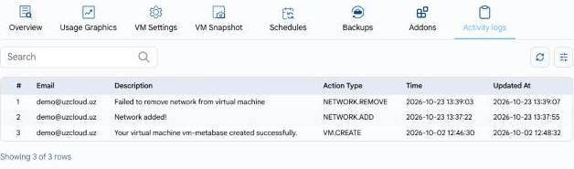

# Журнал активности ВМ

## Отслеживание активности ВМ в UzCloud

В журнале активности ВМ записываются все действия и события, связанные с виртуальной машиной.

- На странице **Virtual Machine Overview** откройте вкладку **Activity logs**.
- Для каждого события указаны email пользователя, описание, тип действия, время и время обновления. С помощью строки поиска можно найти нужные события, например когда ВМ была создана, остановлена или перезагружена.

