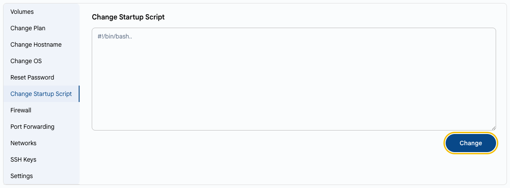

# Изменение скрипта запуска

## Изменение скрипта запуска

Скрипты запуска выполняются автоматически при запуске виртуальной машины. С их помощью можно устанавливать программы, применять обновления и настраивать приложения.

---

- На вкладке **VM Settings** выберите **Change Startup Script**.
- Введите скрипт и нажмите **Change**.

---

### Заключение

Хорошо написанный скрипт запуска обеспечивает единообразную настройку ВМ. Перед сохранением проверьте синтаксис скрипта, чтобы избежать ошибок при запуске.
