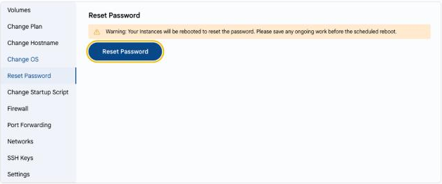

# Сброс пароля

## Сброс пароля ВМ

Если вы потеряли пароль виртуальной машины, его можно сбросить.

---

- На вкладке **VM Settings** выберите **Reset Password**.
- Нажмите **Reset Password**.
- Новый пароль отобразится в поле **Provisioning Password** на вкладке **Overview**.

> [!WARNING]
> Для сброса пароля виртуальная машина будет перезагружена. Сохраните текущую работу заранее.

> [!TIP]
> **См. также:**
>
> - **[Обзор виртуальной машины](../instance-overview.md)**
> - **[SSH-ключи](ssh-keys.md)**
