# Настройка профиля

## Настройка профиля пользователя в UzCloud

Профиль **UzCloud** позволяет управлять личными данными и данными компании, настройками интерфейса и безопасности, доступом к API, пользователями и ролями, квотами и активностью в аккаунте. Чтобы открыть профиль, нажмите на свое имя в правом верхнем углу консоли.

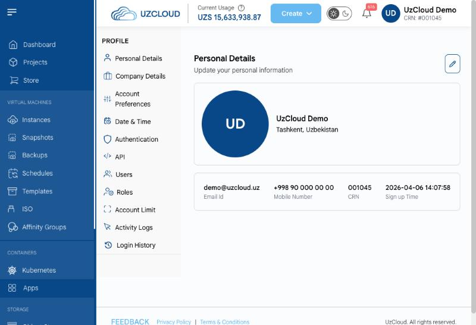

### Обновление личных данных

Поддерживайте личные данные в актуальном состоянии.

- Откройте **Personal Details** в меню профиля.
- Нажмите на значок карандаша, чтобы перейти к редактированию.
- Измените **Name** (имя), **Address Line 1** (адрес), **Country** (страна), **State** (область) и **City** (город).
- Нажмите **Submit**, чтобы сохранить изменения.

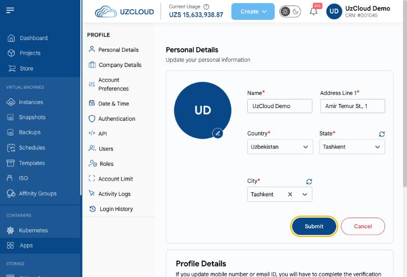

- Чтобы изменить email или номер телефона, нажмите **Change** рядом с полем в блоке **Profile Details**. Новое значение нужно будет подтвердить.

### Данные компании и платежная информация

Корректные платежные данные необходимы для выставления счетов и оплаты.

- Откройте **Company Details** в меню профиля.
- Нажмите на значок карандаша, чтобы перейти к редактированию.
- Заполните **Organization Name** (название организации) и блок **Billing Details**: платежный адрес, сайт, страна, область, город, ИНН, имя плательщика, платежный email и дополнительный платежный email.
- Сохраните изменения.

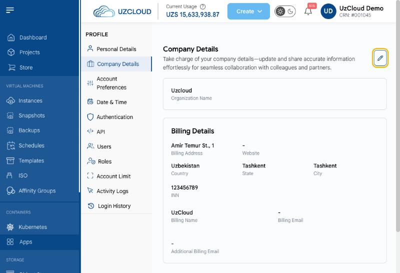

### Настройки аккаунта

- Откройте **Account Preferences** в меню профиля.
- В блоке **Theme mode** выберите **Light Mode** (светлая тема) или **Dark Mode** (темная тема). Изменение применяется сразу.
- В блоке **App Language** выберите язык консоли: **English**, **Russian** или **Uzbek**.

> [!NOTE]
> Скриншоты и названия элементов интерфейса в этой документации приведены для английской версии консоли.

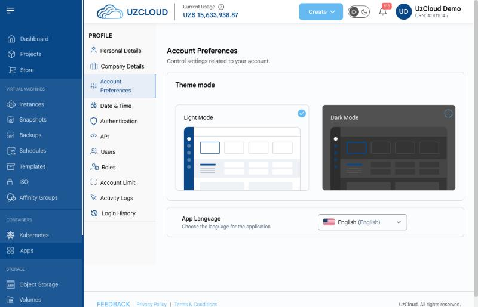

### Настройки даты и времени

- Откройте **Date & Time** в меню профиля.
- Укажите **Preferred Time Zone** (часовой пояс) и **Preferred Date Time Format** (формат даты и времени).
- Нажмите **Submit**, чтобы применить изменения.

> [!NOTE]
> Выбранные часовой пояс и формат используются только для отображения. Все операции обрабатываются в часовом поясе Asia/Samarkand.

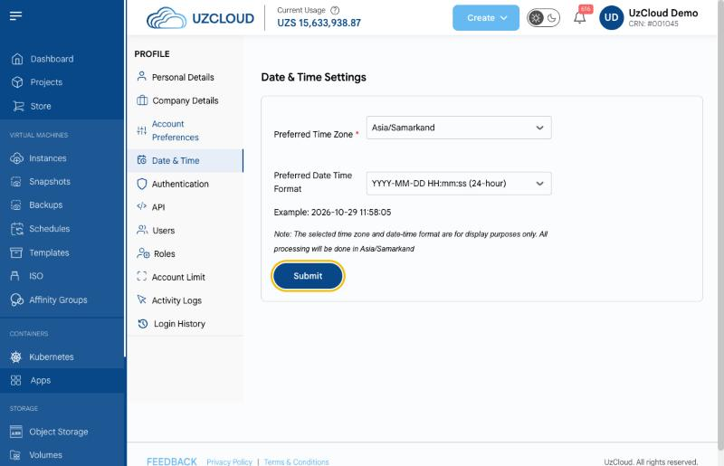

### Двухфакторная аутентификация

Повысьте безопасность, включив **двухфакторную аутентификацию (2FA)**: при каждом входе нужно будет ввести пароль и одноразовый код, отправленный на email.

- Откройте **Authentication** в меню профиля.
- В блоке **Email Authentication** нажмите **SET UP**.
- Подтвердите адрес электронной почты и введите отправленный на него одноразовый код (OTP).
- Чтобы сделать 2FA обязательной для всех пользователей аккаунта, включите переключатель **Enable** в блоке **2FA Enforcement Status**.

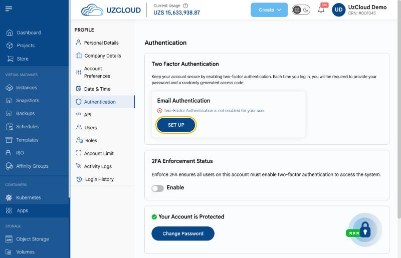

### Смена пароля

- Откройте **Authentication** в меню профиля и нажмите **Change Password**.
- Введите **Current Password** (текущий пароль), затем введите и подтвердите **New Password** (новый пароль).
- Нажмите **Change Password**, чтобы сохранить изменения.

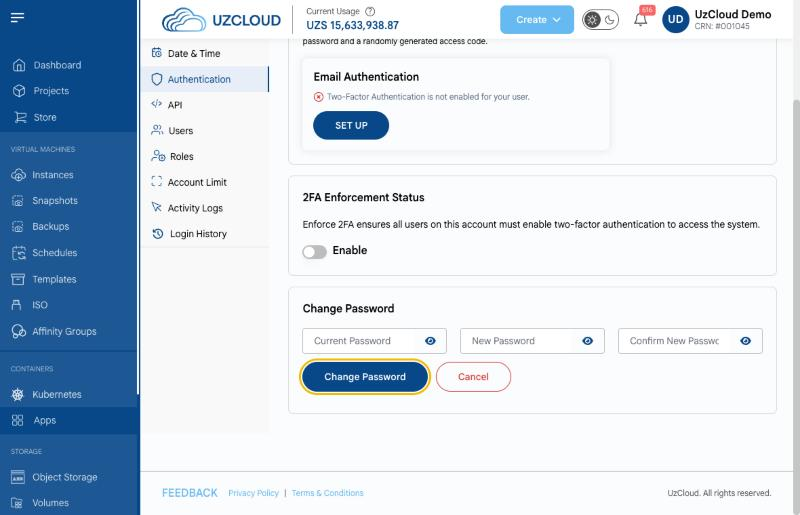

### Доступ к API

Раздел **API** позволяет работать с UzCloud через API с помощью персонального токена доступа.

- Откройте **API** в меню профиля.
- Нажмите **Enable API**, чтобы создать **Personal Access Token**. Под токеном указан срок его действия; скопировать токен можно с помощью значка копирования.
- Чтобы отключить доступ к API, нажмите **Disable API**.
- Ссылки на документацию API указаны в верхней части страницы.

> [!WARNING]
> Храните токен в секрете: любой, у кого он есть, может управлять вашими ресурсами.

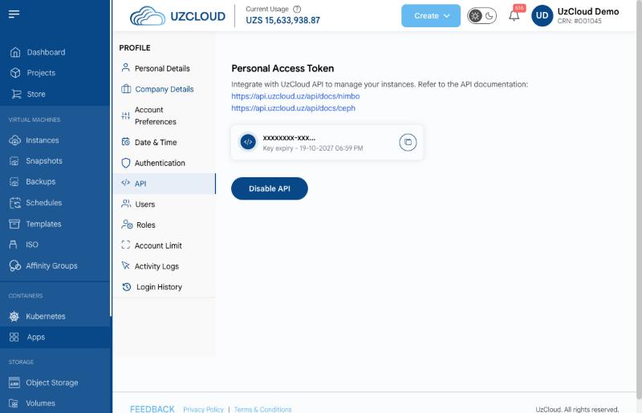

### Добавление нового пользователя

Раздел **Users** позволяет добавлять пользователей в аккаунт и назначать им роли.

- Откройте **Users** в меню профиля. В списке отображаются имя, email, роль, дата создания, последний вход и статус каждого пользователя.
- Нажмите **+ Add New User**, укажите данные пользователя, выберите роль и сохраните.
- В меню **Actions** можно изменить пользователя или повторно отправить приглашение.

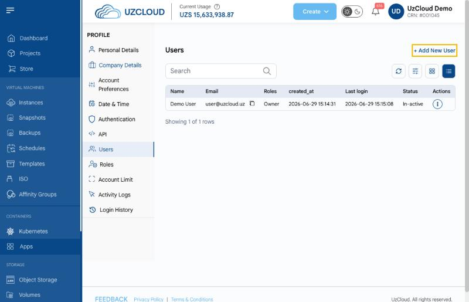

### Роли и права пользователей

В разделе **Roles** отображаются доступные роли и их права.

- Откройте **Roles** в меню профиля.
- Выберите роль, чтобы увидеть ее описание и права. Предустановленные роли: **Owner**, **Service Administrator** и **Service Viewer**.
- Нажмите кнопку **+**, чтобы создать новую роль с собственным набором прав.

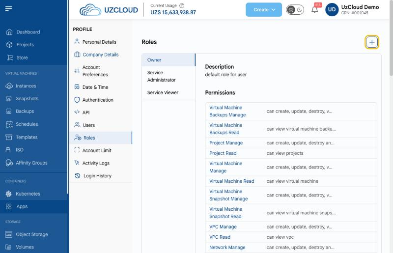

### Квоты и их увеличение

Раздел **Account Limit** (страница **Quota**) показывает лимиты и использование ресурсов в каждой зоне.

- Откройте **Account Limit** в меню профиля.
- На вкладке **Quota Limits** выберите зону, чтобы увидеть лимит, использование и доступный объем каждого ресурса.
- Нажмите **Request To Increase** рядом с ресурсом, чтобы запросить увеличение лимита. Статус запроса отображается в столбце **Request Status**.
- На вкладке **Quota Usages Report** доступен отчет об использовании квот.

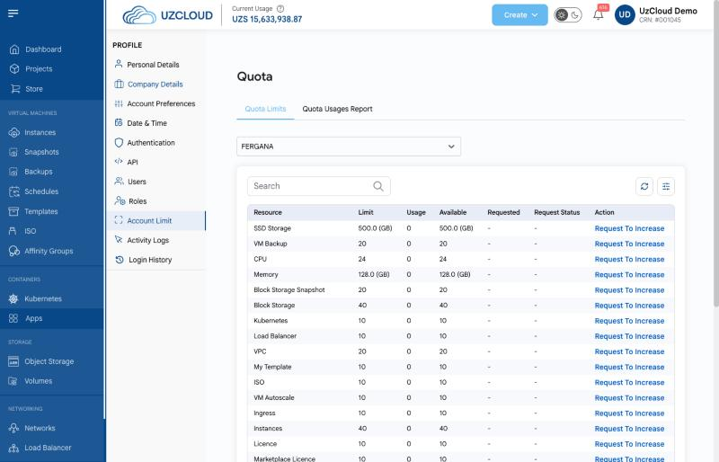

### Журнал активности

Раздел **Activity Logs** содержит записи о действиях в аккаунте: IP-адрес, пользователь, проект, тип действия, описание, время и статус.

- Откройте **Activity Logs** в меню профиля.
- Используйте строку поиска, чтобы отфильтровать записи по ключевым словам.

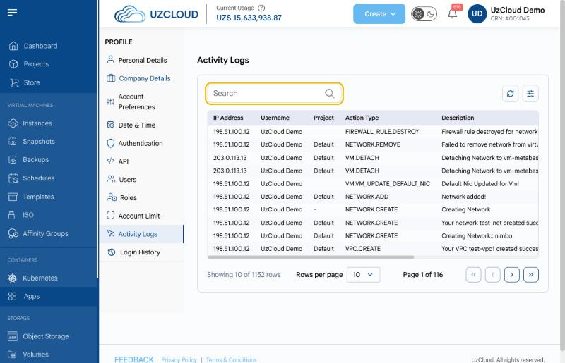

### История входов

Раздел **Login History** показывает все входы в аккаунт, включая неудачные попытки.

- Откройте **Login History** в меню профиля.

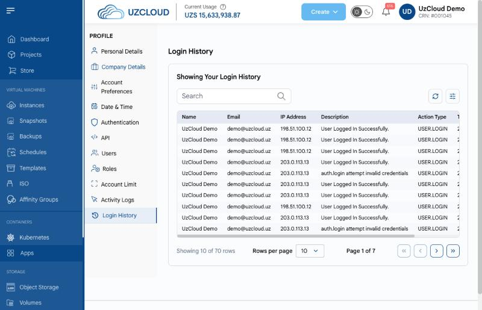

### Заключение

Следуя этому руководству, вы сможете управлять профилем UzCloud, повысить безопасность аккаунта и настроить консоль под свои задачи.
