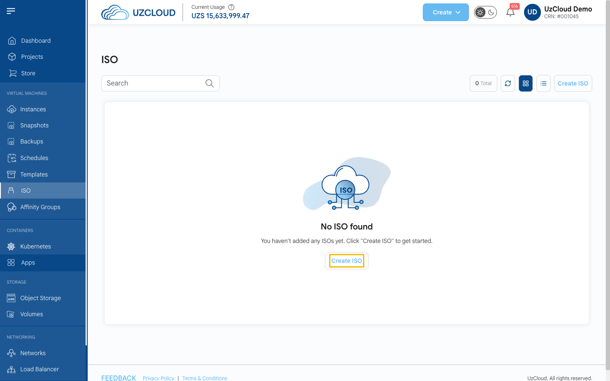
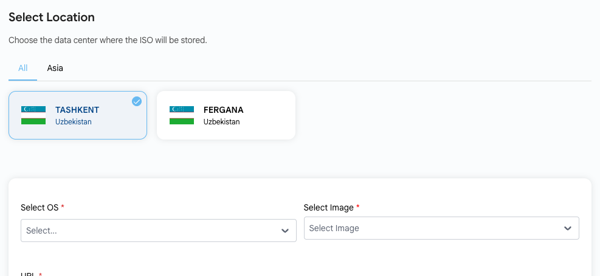
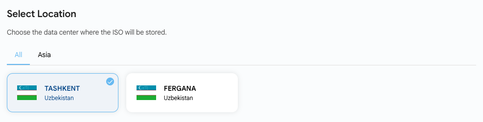
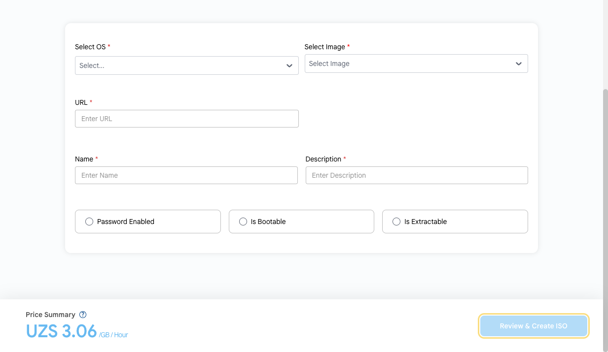

# Импорт ISO

## ISO-образ

**ISO-образ** — файл образа диска, содержащий точную копию файловой системы. В UzCloud можно импортировать собственный ISO-образ, чтобы установить на виртуальную машину нестандартную операционную систему или инструменты.

---

### Импорт ISO-образа

- В меню слева нажмите **ISO**. На странице отображаются ваши ISO-образы.
- Нажмите **Create ISO**. Откроется страница **Create ISO**.

- Выберите проект, к которому будет относиться ISO-образ.

- Выберите расположение, в котором будет храниться ISO-образ.

### Параметры ISO

- **Select OS** — операционная система ISO-образа.
- **Select Image** — тип образа.
- **URL** — ссылка на ISO-файл, который будет импортирован.
- **Name** и **Description** — имя и краткое описание ISO-образа.

Дополнительные параметры:

- **Password Enabled** — образ поддерживает установку пароля.
- **Is Bootable** — с этого ISO можно загрузить ВМ (например, для установки ОС).
- **Is Extractable** — ISO-образ можно скачать (извлечь) после импорта.

Проверьте **Price Summary** (стоимость хранения ISO рассчитывается за ГБ в час) и нажмите **Review & Create ISO**.

> [!TIP]
> Чтобы подключить ISO-образ к виртуальной машине, нажмите **Attach ISO To This Virtual Machine** на странице ВМ.

### Заключение

ISO-образы позволяют установить на виртуальные машины любую операционную систему или инструменты. Если нужна помощь, изучите документацию UzCloud или обратитесь в поддержку.

> [!TIP]
> **См. также:**
>
> - **[Виртуальная машина](../compute/compute-instance.md)**
> - **[Создание шаблонов](../templates/create-templates.md)**
