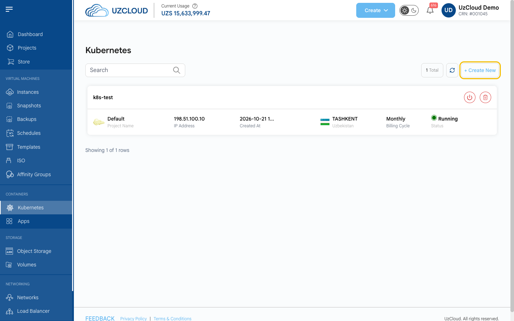
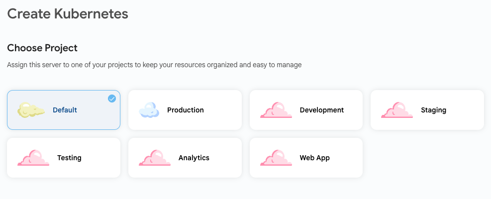
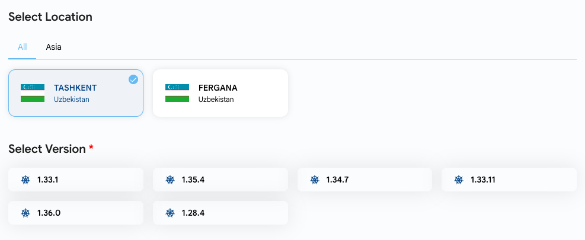
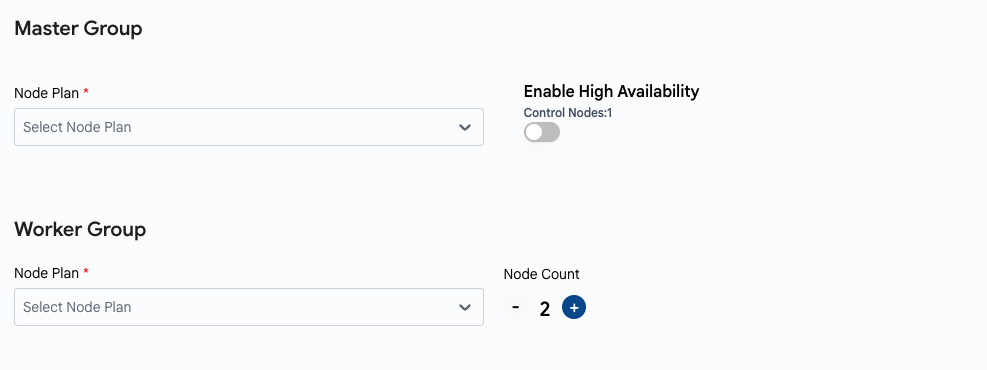
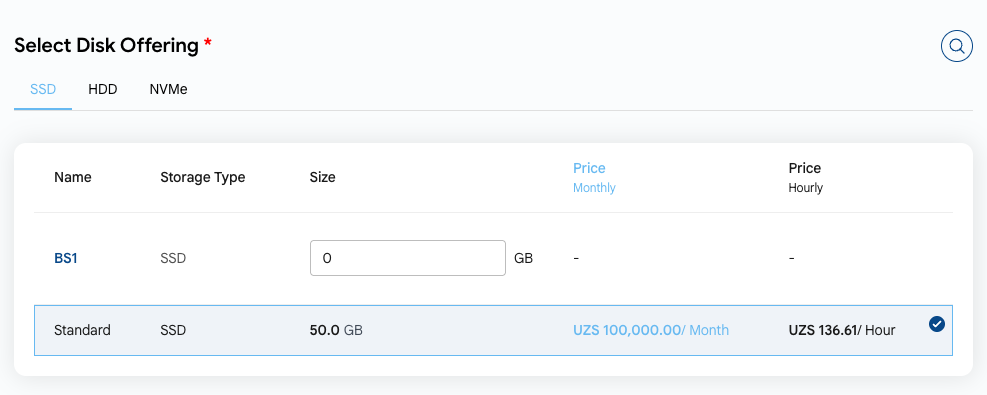
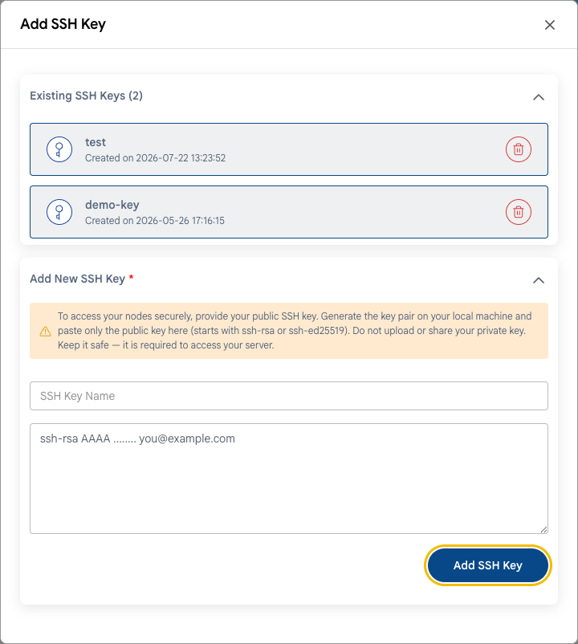
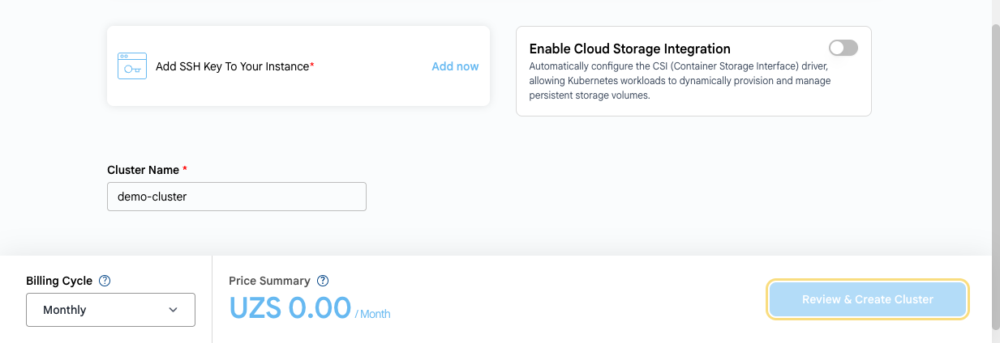

# Создание кластера Kubernetes

## Кластер Kubernetes

Кластер **Kubernetes** — это набор преднастроенных машин (узлов), которые совместно запускают контейнерные приложения автоматически и масштабируемо. Kubernetes управляет развертыванием, масштабированием и работой контейнеров приложений на нескольких узлах.

В **UzCloud** управляемый кластер Kubernetes создается за несколько шагов: консоль сама создает управляющие и рабочие узлы, сеть кластера и балансировщик нагрузки для API.

---

### Откройте страницу Kubernetes

- В левом меню в разделе **CONTAINERS** нажмите **Kubernetes**. На странице перечислены ваши кластеры: проект, IP-адрес, дата создания, расположение, цикл оплаты и статус.
- Нажмите **+ Create New** в правом верхнем углу. Откроется страница **Create Kubernetes**.

### Выберите проект

- Привяжите кластер к одному из своих проектов, чтобы упорядочить ресурсы.

### Выберите расположение и версию

- Выберите дата-центр, в котором будет развернут кластер: **TASHKENT** или **FERGANA**.
- В блоке **Select Version** выберите версию Kubernetes.

### Настройте группы узлов

- **Master Group** — выберите **Node Plan** для управляющих узлов. Включите **Enable High Availability**, чтобы запустить несколько управляющих узлов вместо одного (по умолчанию **Control Nodes: 1**).
- **Worker Group** — выберите **Node Plan** для рабочих узлов и задайте их количество в поле **Node Count** (по умолчанию 2). На рабочих узлах выполняются ваши нагрузки.

### Выберите диск

- В блоке **Select Disk Offering** выберите тип диска (**SSD**, **HDD** или **NVMe**) и диск для узлов. Для каждого варианта указаны цены за месяц и за час.

### SSH-ключ, хранилище и имя кластера

- SSH-ключ обязателен. Нажмите **Add now** рядом с **Add SSH Key To Your Instance**, выберите существующий ключ или укажите имя и вставьте открытый ключ, затем нажмите **Add SSH Key**.

- Включите **Enable Cloud Storage Integration**, чтобы автоматически настроить драйвер CSI (Container Storage Interface). Тогда нагрузки Kubernetes смогут динамически создавать постоянные тома и управлять ими.
- Укажите уникальное имя кластера в поле **Cluster Name**.

### Создайте кластер

- Внизу страницы выберите **Billing Cycle** (цикл оплаты): **Monthly** (ежемесячно) или **Yearly** (ежегодно). В **Price Summary** показана стоимость выбранной конфигурации.
- Проверьте конфигурацию и нажмите **Review & Create Cluster**.

> [!NOTE]
> Выбирать сеть не нужно: UzCloud создает для кластера отдельную сеть (например, `k8s-test-network`) и балансировщик нагрузки для Kubernetes API.

### Заключение

Следуя этому руководству, вы создадите кластер Kubernetes в UzCloud за несколько минут. Кластеры Kubernetes — мощный инструмент для развертывания, масштабирования и управления контейнерными приложениями с высокой доступностью. Если нужна помощь, изучите документацию UzCloud или обратитесь в поддержку.

> [!TIP]
> **См. также:**
>
> - **[Управление кластером Kubernetes](kubernetes-cluster-overview.md)**
> - **[Балансировщик нагрузки](../load-balancer/load-balancer.md)**
> - **[Группы привязки](../affinity-groups/create-affinity-groups.md)**
