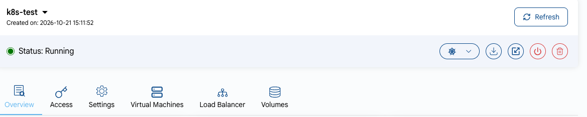
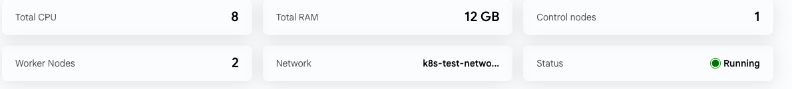
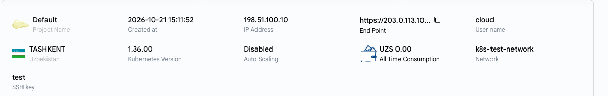
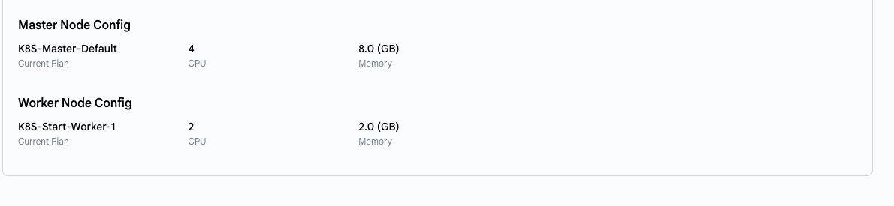
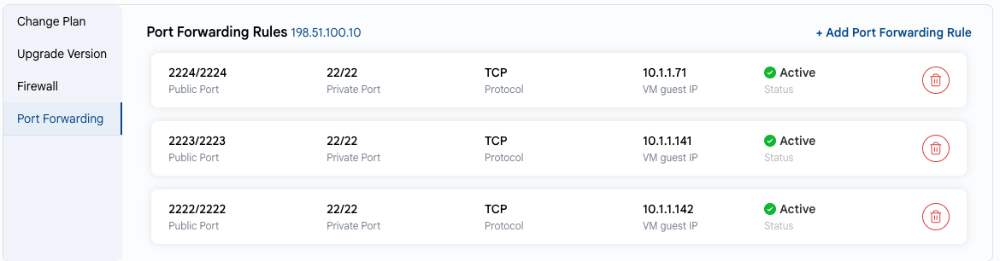

# Обзор кластера Kubernetes

## Обзор кластера Kubernetes в UzCloud

Страница **Kubernetes Overview** содержит подробную сводку о кластере и быстрые действия для управления им: конфигурацию, планы узлов, связанные виртуальные машины, балансировщики нагрузки и тома.

---

### Кнопки действий

- На странице **Kubernetes** на карточке каждого кластера есть кнопки **Power Off** и **Delete**. Нажмите на имя кластера, чтобы открыть страницу **Kubernetes Overview**.
- Кнопки действий расположены справа в строке статуса.

- **Refresh** — обновляет статус и данные кластера.
- **Upgrade Kubernetes Version** — обновляет кластер до более новой версии Kubernetes.
- **Download config file** — скачивает файл `kubeconfig` для работы с кластером через `kubectl` и другие CLI-инструменты.
- **Scale Kubernetes Cluster** — изменяет количество рабочих узлов.
- **Power Off** — выключает весь кластер.
- **Delete** — безвозвратно удаляет кластер и все его ресурсы.

На странице есть вкладки:

- **Overview** — сводка о кластере, описанная ниже.
- **Access** — скачивание конфигурации кластера и инструкции по подключению через CLI и Kubernetes Dashboard.
- **Settings** — **Change Plan** (смена планов управляющих и рабочих узлов), **Upgrade Version**, **Firewall** и **Port Forwarding**.
- **Virtual Machines** — узлы кластера.
- **Load Balancer** — балансировщики нагрузки кластера (включая балансировщик для API).
- **Volumes** — диски узлов кластера.

### Сводка о кластере

- **Total CPU** — общее количество vCPU на всех узлах кластера.
- **Total RAM** — общий объем памяти, выделенной кластеру.
- **Control nodes** — количество узлов, которые управляют состоянием кластера.
- **Worker Nodes** — количество узлов, на которых выполняются ваши нагрузки.
- **Network** — сеть, в которой развернут кластер.
- **Status** — текущее состояние кластера (например, Running).

### Информация о кластере

- **Project Name** — проект, к которому относится кластер.
- **Created at** — дата и время создания кластера.
- **IP Address** — публичный IP-адрес кластера.
- **End Point** — адрес API-сервера Kubernetes. Чтобы скопировать его, нажмите на значок копирования.
- **User name** — имя пользователя по умолчанию на узлах кластера.
- **Расположение** — дата-центр, в котором работает кластер.
- **Kubernetes Version** — версия Kubernetes в кластере.
- **Auto Scaling** — включено ли автоматическое масштабирование узлов.
- **All Time Consumption** — стоимость кластера за все время с момента создания.
- **Network** — имя сети кластера.
- **SSH key** — SSH-ключ для доступа к узлам кластера.

### Конфигурация узлов

- **Master Node Config** и **Worker Node Config** — планы управляющих и рабочих узлов: **Current Plan**, **CPU** и **Memory**.

### Публикация сервиса Kubernetes

Сервисы Kubernetes доступны на определенном порту. Чтобы сервис был доступен из интернета, откройте этот порт на вкладке **Settings → Firewall** кластера и создайте правило на вкладке **Settings → Port Forwarding**. Нажмите **+ Add Port Forwarding Rule** и укажите публичный порт, внутренний порт, протокол и узел.

---

### Заключение

Страница **Kubernetes Overview** дает централизованное представление о состоянии, конфигурации и использовании ресурсов кластера. Кнопки действий упрощают обслуживание кластера, а подробные характеристики помогают в мониторинге и планировании.

> [!TIP]
> **См. также:**
>
> - **[Создание кластера Kubernetes](create-kubernetes-cluster.md)**
> - **[Кластер Kubernetes через CLI](kubernetes-cluster-via-cli.md)**
> - **[Доступ к Kubernetes Dashboard](kubernetes-dashboard-ui-access.md)**
