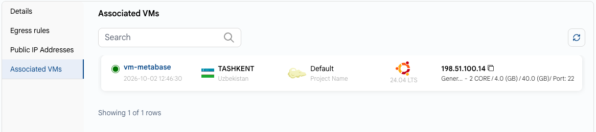

# Связанные ВМ

## Связанные ВМ

На вкладке **Associated VMs** страницы сети перечислены ВМ, подключенные к сети: статус, расположение, проект, операционная система, IP-адрес и конфигурация. Используйте поиск, чтобы найти нужную ВМ.

### Заключение

Вкладка **Associated VMs** наглядно показывает все ВМ, связанные с сетью, и помогает отслеживать подключенные ресурсы и управлять ими.
