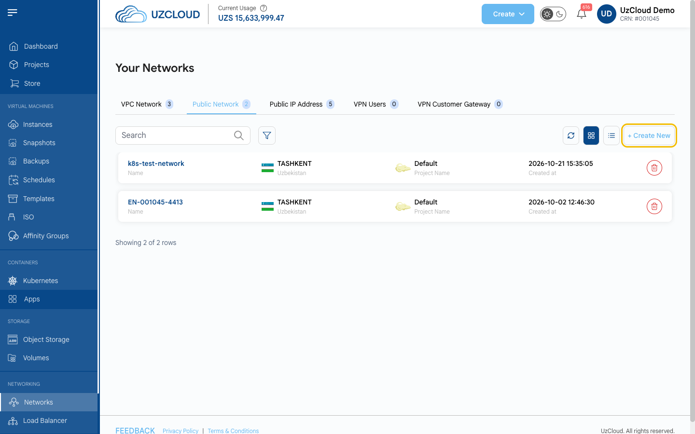
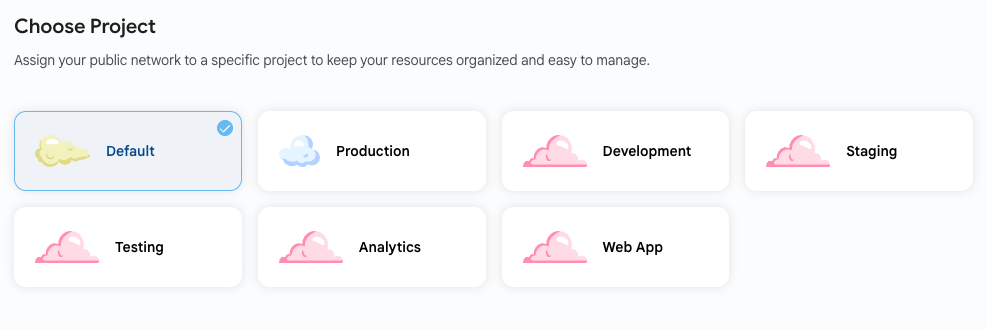
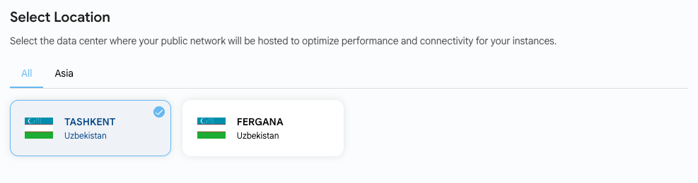
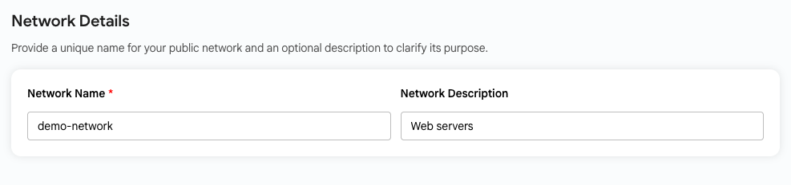
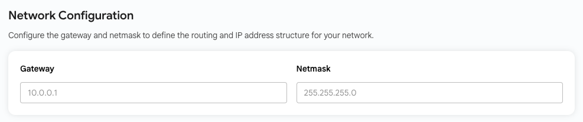
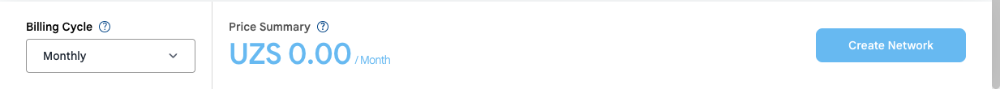

# Создание публичной сети

## Создание публичной сети

**Публичная сеть** в UzCloud — это изолированная гостевая сеть со встроенным облачным брандмауэром. Она дает ВМ доступ в интернет через публичный IP-адрес, а правила трафика, проброс портов и VPN удаленного доступа настраиваются без сложной конфигурации.

- В левом меню в разделе **NETWORKING** нажмите **Networks** и откройте вкладку **Public Network**.
- Нажмите **+ Create New** в правом верхнем углу. Откроется страница **Create Isolated Network**.

### Выберите проект

- Привяжите сеть к одному из своих проектов, чтобы упорядочить ресурсы.

### Выберите расположение

- Выберите дата-центр, в котором будет размещена сеть: **TASHKENT** или **FERGANA**.

### Сведения о сети

- Укажите уникальное имя в поле **Network Name** и при желании описание в поле **Network Description**.

### Конфигурация сети

- При необходимости задайте шлюз (**Gateway**, например `10.0.0.1`) и маску (**Netmask**, например `255.255.255.0`) сети. Если оставить поля пустыми, используются значения по умолчанию.

### Создайте сеть

- Внизу страницы выберите **Billing Cycle** (цикл оплаты): **Monthly** (ежемесячно) или **Yearly** (ежегодно). В **Price Summary** показана стоимость.
- Проверьте конфигурацию и нажмите **Create Network**.

### Заключение

Публичная сеть подключает ВМ к интернету и защищает их встроенным брандмауэром. После создания сети настройте правила исходящего трафика и ее публичный IP-адрес.

> [!TIP]
> **См. также:**
>
> - **[Обзор публичной сети](network-overview.md)**
> - **[Публичные IP-адреса](public-ip-addresses.md)**
