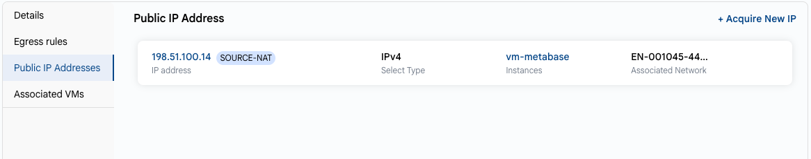

# Публичные IP-адреса

## Публичные IP-адреса

Публичные IP-адреса позволяют ресурсам сети взаимодействовать с интернетом.

- На странице сети откройте вкладку **Public IP Addresses**. На ней перечислены IP-адреса сети: тип, ВМ и связанная сеть. Адрес **SOURCE-NAT** назначается сети автоматически и используется для исходящего трафика.

- Чтобы получить еще один адрес, нажмите **+ Acquire New IP**, выберите **Billing Cycle** и нажмите **Buy IP**.

- Чтобы настроить брандмауэр, проброс портов и VPN для адреса, нажмите на него или см. **[Публичный IP-адрес](../public-ip-address.md)**.

### Заключение

На вкладке **Public IP Addresses** можно просматривать, получать и настраивать IP-адреса сети.

> [!TIP]
> **См. также:**
>
> - **[Обзор публичной сети](network-overview.md)**
> - **[Создание публичной сети](create-public-network.md)**
