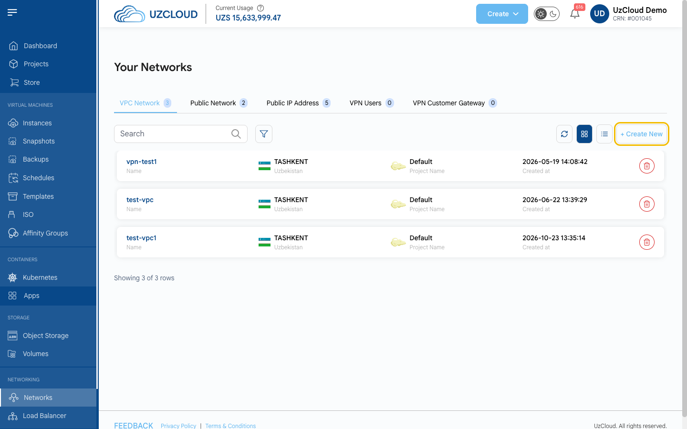
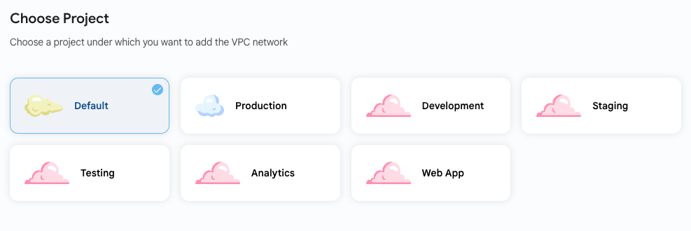
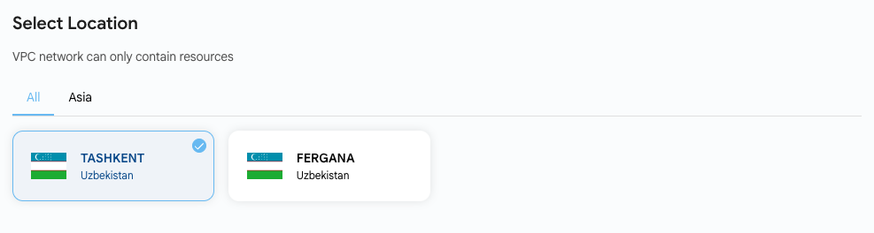
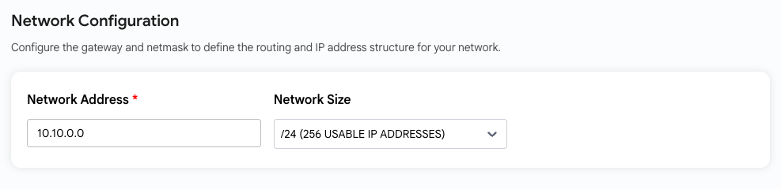
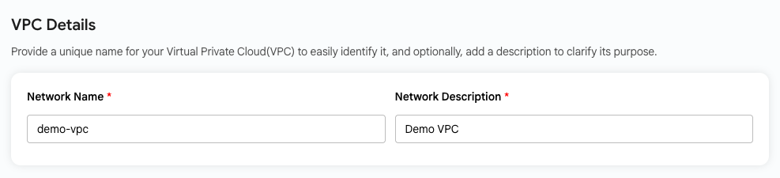
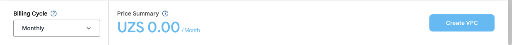

# Создание VPC-сетей

## Создание VPC-сетей

**VPC-сеть** (Virtual Private Cloud) в UzCloud дает полный контроль над сетью. Помимо правил брандмауэра, проброса портов и VPN удаленного доступа, в ней можно настроить VPN-шлюзы и VPN-соединения «сеть — сеть», добавить несколько сетей (уровней) и управлять трафиком между ними с помощью ACL.

- В левом меню в разделе **NETWORKING** нажмите **Networks**. Откроется страница **Your Networks** на вкладке **VPC Network**.
- Нажмите **+ Create New** в правом верхнем углу. Откроется страница **Create VPC Network**.

### Выберите проект

- Привяжите VPC к одному из своих проектов, чтобы упорядочить ресурсы.

### Выберите расположение

- Выберите дата-центр, в котором будет создана VPC: **TASHKENT** или **FERGANA**. VPC может содержать только ресурсы из того же расположения.

### Конфигурация сети

- **Network Address** — базовый адрес адресного пространства VPC (например, `10.10.0.0`).
- **Network Size** — размер адресного пространства: от **/16** (65 536 адресов) до **/30**. По умолчанию — **/24** (256 адресов).

### Сведения о VPC

- Укажите уникальное имя в поле **Network Name** и описание назначения VPC в поле **Network Description**.

### Создайте VPC

- Внизу страницы выберите **Billing Cycle** (цикл оплаты): **Monthly** (ежемесячно) или **Yearly** (ежегодно). В **Price Summary** показана стоимость.
- Проверьте конфигурацию и нажмите **Create VPC**.

### Заключение

**VPC-сеть** в UzCloud — безопасная, изолированная и гибкая среда для облачных ресурсов. После создания VPC добавьте в нее сети и при необходимости настройте ACL и VPN.

> [!TIP]
> **См. также:**
>
> - **[Обзор VPC-сети](network-overview.md)**
> - **[Добавление сети](add-network.md)**
> - **[Список сетевых ACL](network-acl-list.md)**
> - **[VPN-соединения](vpn-connections.md)**
