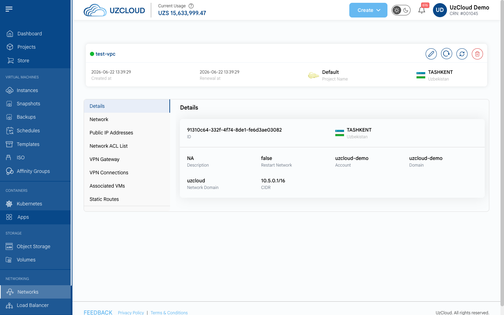
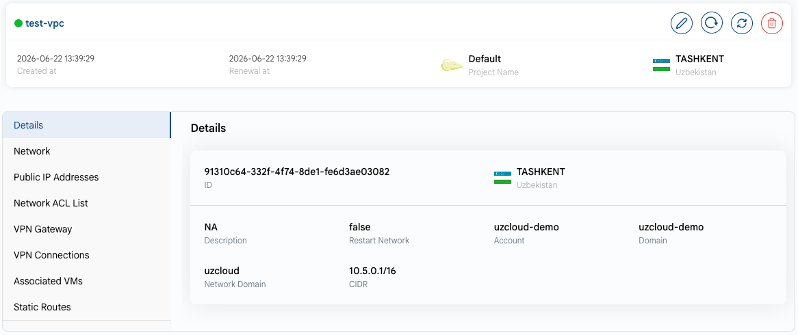
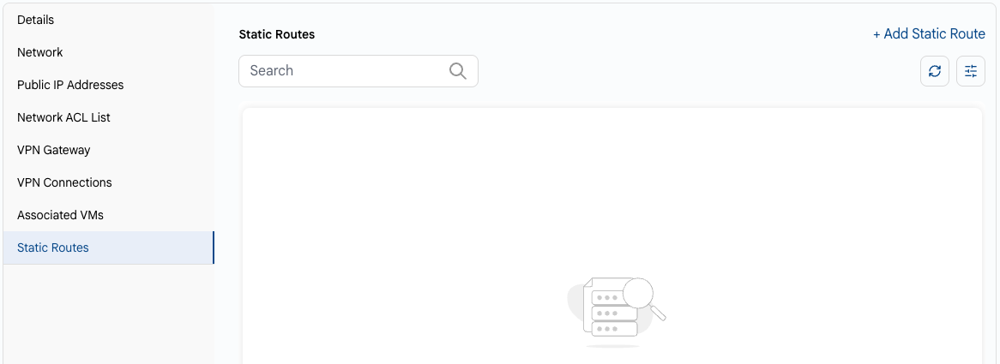
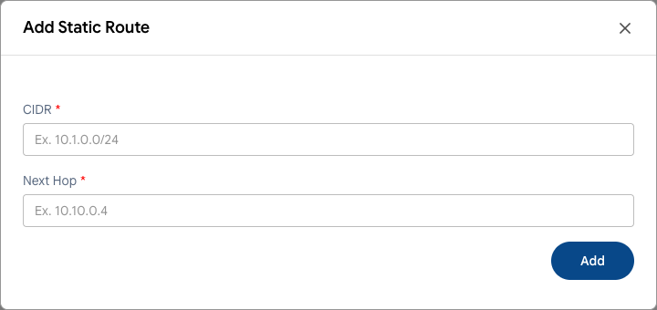

# Обзор сети

## Обзор VPC-сети

Чтобы открыть VPC, нажмите на ее имя на вкладке **VPC Network** страницы **Networks**. На странице VPC показаны даты создания и продления, проект и расположение. Вкладки слева открывают настройки VPC.

### Кнопки действий

Кнопки действий расположены в правом верхнем углу карточки VPC:

- **Update vpc** — изменяет имя и описание VPC.
- **Restart** — перезапускает сеть VPC.
- **Refresh** — обновляет данные VPC.
- **Delete** — удаляет VPC.

### Сведения

На вкладке **Details** показаны основные параметры VPC.

- **ID** — идентификатор VPC.
- **Расположение** — дата-центр VPC.
- **Description** — описание VPC.
- **Restart Network** — нужно ли перезапустить сеть, чтобы применить изменения (true/false).
- **Account** и **Domain** — учетная запись и домен, которым принадлежит VPC.
- **Network Domain** — DNS-домен для внутреннего взаимодействия в VPC.
- **CIDR** — адресное пространство VPC.

### Вкладки VPC

- **[Network](add-network.md)** — сети (уровни), созданные внутри VPC.
- **[Public IP Addresses](public-ip-address.md)** — публичные IP-адреса VPC.
- **[Network ACL List](network-acl-list.md)** — списки управления доступом для сетей VPC.
- **[VPN Gateway](vpn-gateway.md)** — VPN-шлюз VPC для соединений «сеть — сеть».
- **[VPN Connections](vpn-connections.md)** — VPN-соединения «сеть — сеть».
- **[Associated VMs](associated-vms.md)** — ВМ, подключенные к VPC.
- **Static Routes** — статические маршруты VPC (см. ниже).

### Статические маршруты

Статические маршруты направляют трафик для заданного диапазона адресов на указанный следующий узел.

- На вкладке **Static Routes** нажмите **+ Add Static Route**.
- Укажите диапазон назначения в поле **CIDR** и адрес следующего узла в поле **Next Hop**, затем нажмите **Add**.

### Заключение

Страница VPC содержит основные сведения о виртуальном частном облаке и дает доступ ко всем его настройкам: сетям, IP-адресам, ACL, VPN и маршрутам.

> [!TIP]
> **См. также:**
>
> - **[Создание VPC-сети](create-vpc-network.md)**
> - **[VPN-шлюз](vpn-gateway.md)**
> - **[VPN-соединения](vpn-connections.md)**
