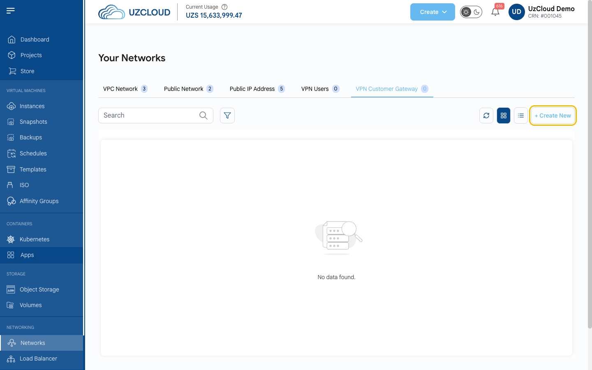
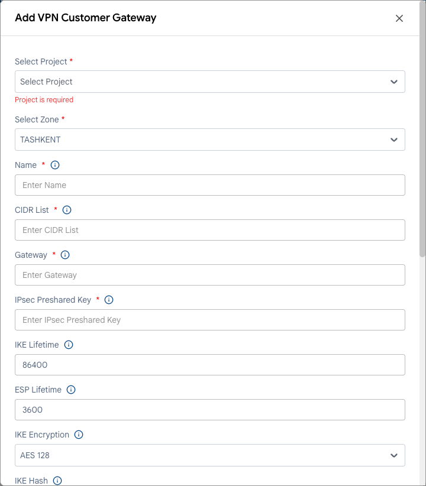
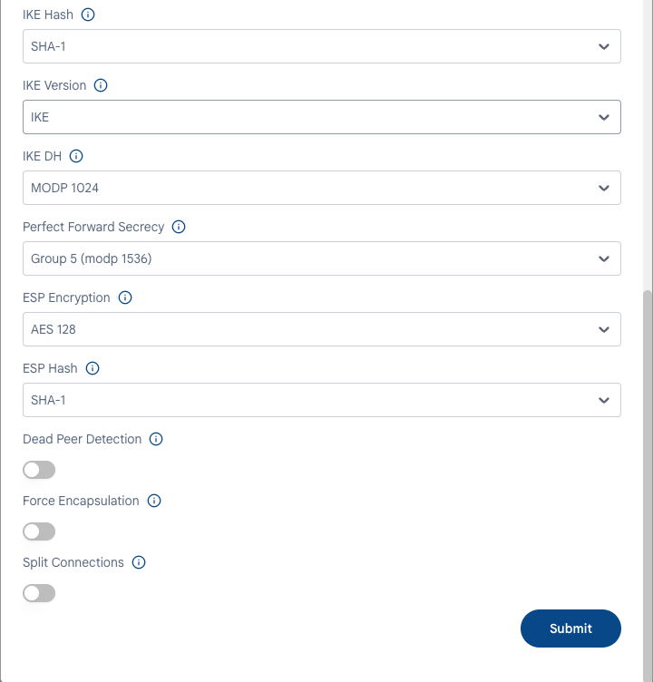

# Клиентский VPN-шлюз

## Клиентский VPN-шлюз (VPN Customer Gateway)

**Клиентский VPN-шлюз** описывает вашу сторону VPN-соединения «сеть — сеть»: локальное VPN-устройство и его параметры IPsec. Он нужен, чтобы соединить VPC в UzCloud с вашей частной сетью.

- В левом меню в разделе **NETWORKING** нажмите **Networks** и откройте вкладку **VPN Customer Gateway**.
- Нажмите **+ Create New**. Откроется форма **Add VPN Customer Gateway**.

### Основные параметры

- **Select Project** — проект для шлюза.
- **Select Zone** — зона (расположение) шлюза.
- **Name** — уникальное имя шлюза.
- **CIDR List** — диапазоны адресов вашей локальной сети в формате CIDR.
- **Gateway** — публичный IP-адрес вашего VPN-устройства (маршрутизатора или брандмауэра).
- **IPsec Preshared Key** — общий секретный ключ для аутентификации VPN-устройств.
- **IKE Lifetime** — время жизни сессии IKE в секундах (по умолчанию 86400).
- **ESP Lifetime** — время жизни сессии ESP в секундах (по умолчанию 3600).

### Параметры шифрования

Значения должны совпадать с настройками вашего VPN-устройства.

- **IKE Encryption** и **IKE Hash** — алгоритмы шифрования и хеширования для фазы IKE (по умолчанию AES 128 и SHA-1).
- **IKE Version** — версия протокола IKE.
- **IKE DH** — группа Диффи — Хеллмана для обмена ключами (по умолчанию MODP 1024).
- **Perfect Forward Secrecy** — группа DH для PFS (по умолчанию Group 5 (modp 1536)).
- **ESP Encryption** и **ESP Hash** — алгоритмы шифрования и хеширования для ESP (по умолчанию AES 128 и SHA-1).
- **Dead Peer Detection** — обнаруживает потерю соединения и восстанавливает его.
- **Force Encapsulation** — принудительно инкапсулирует пакеты ESP в UDP, чтобы VPN работал через NAT.
- **Split Connections** — создает отдельный туннель для каждого CIDR из списка.
- Нажмите **Submit**.

> [!TIP]
> Используйте более стойкие алгоритмы (например, AES 256 и SHA-256), если их поддерживает ваше VPN-устройство.

После создания шлюза выберите его при создании VPN-соединения на странице VPC — см. **[VPN-соединения](vpc-network/vpn-connections.md)**.

### Заключение

**Клиентский VPN-шлюз** обеспечивает защищенное соединение между вашей локальной инфраструктурой и VPC в UzCloud.

> [!TIP]
> **См. также:**
>
> - **[Пользователи VPN](vpn-users.md)**
