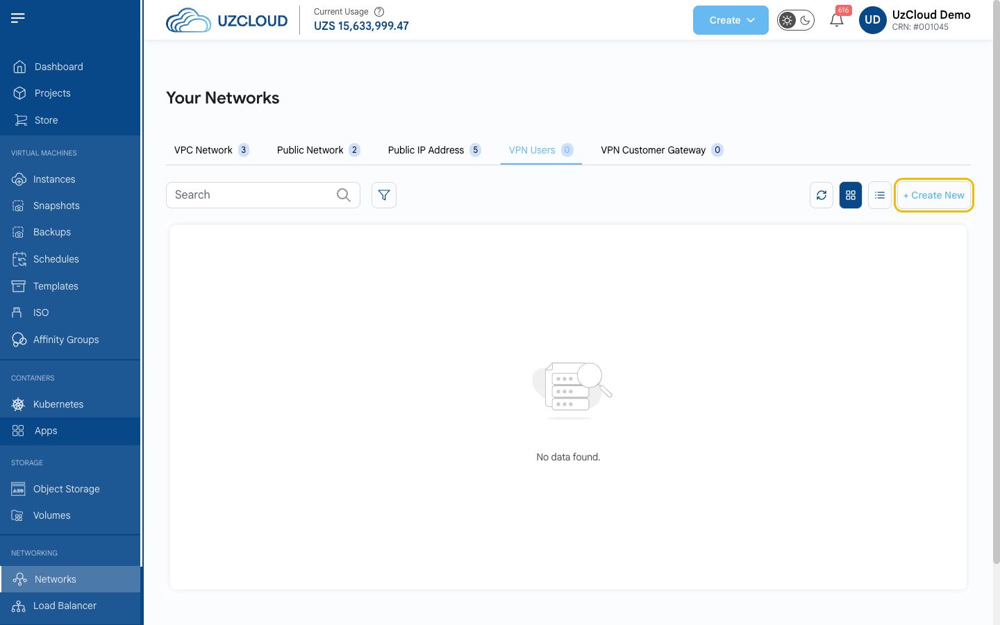
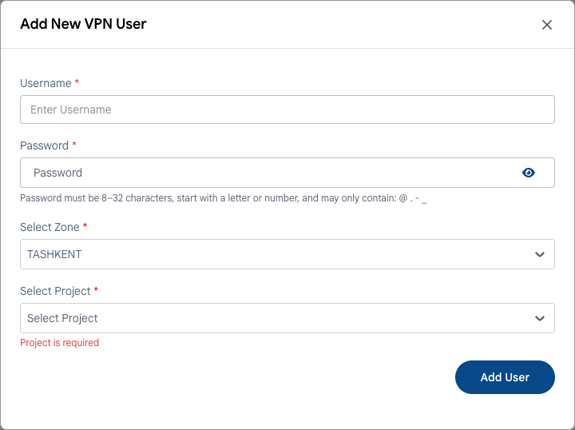

# Пользователи VPN

## Пользователи VPN

**Пользователь VPN** — учетная запись для подключения к частным сетям UzCloud через VPN удаленного доступа.

- В левом меню в разделе **NETWORKING** нажмите **Networks** и откройте вкладку **VPN Users**.
- Нажмите **+ Create New**.

- Укажите имя пользователя (**Username**) и пароль (**Password**). Пароль должен содержать от 8 до 32 символов, начинаться с буквы или цифры и состоять только из букв, цифр и символов `@ . - _`.
- Выберите зону (**Zone**) и проект (**Project**).
- Нажмите **Add User**.

> [!NOTE]
> Для подключения на публичном IP-адресе сети должен быть включен VPN удаленного доступа. См. **[Публичный IP-адрес](public-ip-address.md)**.

### Заключение

Вкладка **VPN Users** позволяет добавлять пользователей для защищенного удаленного доступа к облачным ресурсам и управлять ими.

> [!TIP]
> **См. также:**
>
> - **[Клиентский VPN-шлюз](vpn-customer-gateway.md)**
