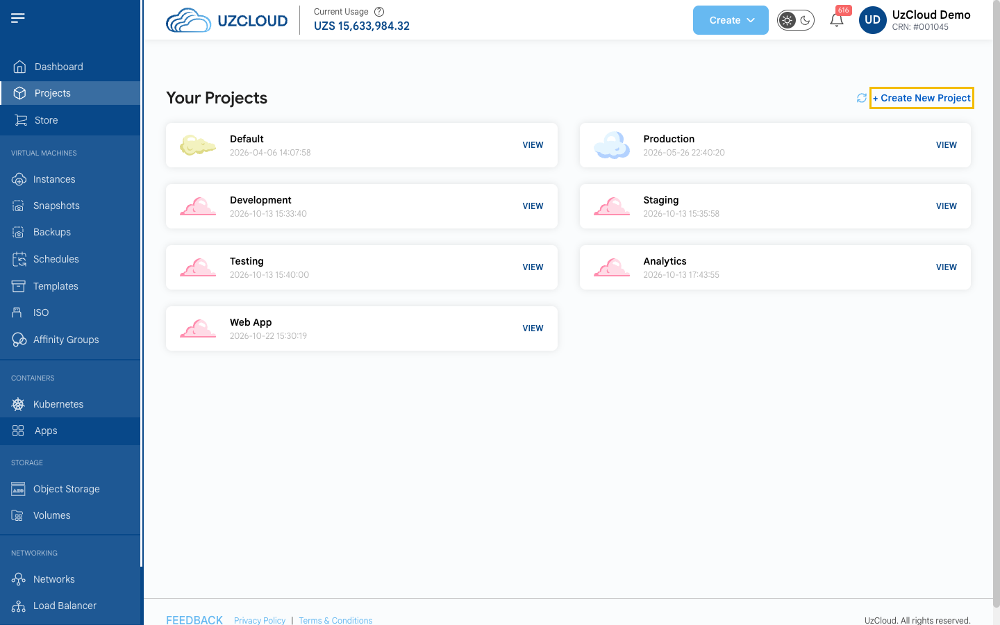
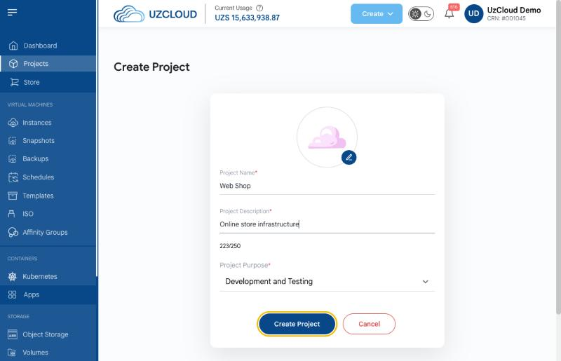
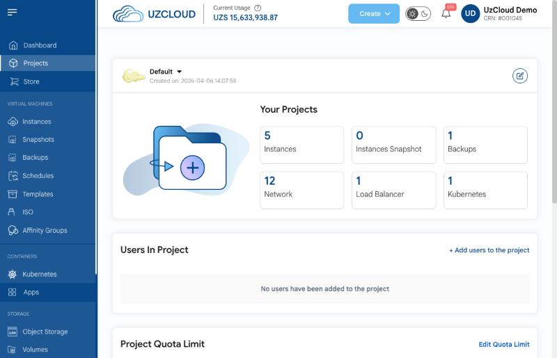
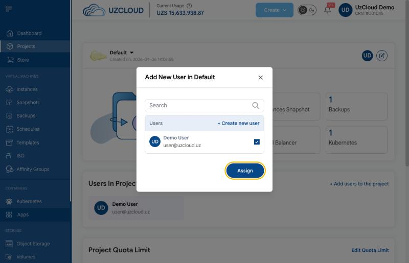
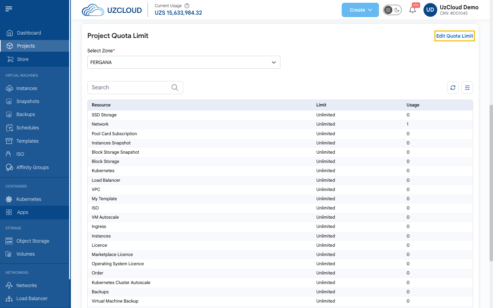
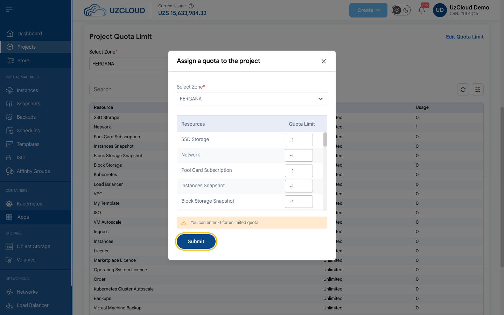

# Создание проекта

## Создание проекта и управление им

Проекты помогают группировать ресурсы и управлять доступом к ним. В этом руководстве описано, как создать проект в UzCloud, добавить в него пользователей и задать квоты для проекта.

### Создание нового проекта

- В меню слева нажмите **Projects**. На странице отображаются все ваши проекты.
- Нажмите **+ Create New Project**.

- Введите **Project Name** (название) и **Project Description** (описание, до 250 символов) и выберите **Project Purpose** (назначение). При желании смените значок проекта, нажав на карандаш на изображении.
- Нажмите **Create Project**.

### Просмотр ресурсов проекта

Чтобы открыть проект, нажмите **VIEW** на его карточке. На странице проекта отображается количество ресурсов: **Instances**, **Instances Snapshot**, **Backups**, **Network**, **Load Balancer** и **Kubernetes**. Чтобы изменить название и описание проекта, нажмите на значок карандаша в правом верхнем углу.

### Добавление пользователей в проект

- В блоке **Users In Project** нажмите **+ Add users to the project**.
- Найдите пользователей с помощью строки поиска, отметьте их флажками и нажмите **Assign**.
- Если пользователя еще нет, нажмите **+ Create new user**.

### Настройка квот проекта

В блоке **Project Quota Limit** отображаются лимит и использование каждого ресурса проекта в выбранной зоне.

- Выберите зону в поле **Select Zone**.

- Нажмите **Edit Quota Limit**. Откроется окно **Assign a quota to the project**.
- Выберите зону и укажите **Quota Limit** для ресурсов, которые нужно ограничить. Значение `-1` означает **неограниченную** квоту.
- Нажмите **Submit**.

Следуя этому руководству, вы сможете создавать проекты в UzCloud и управлять ими, организовать доступ команды и контролировать потребление ресурсов.
