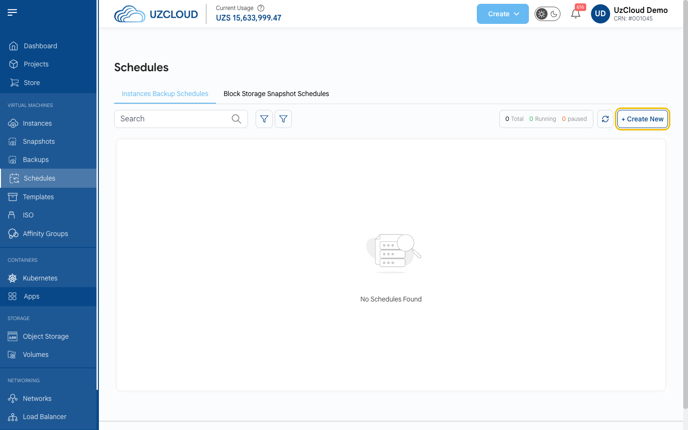
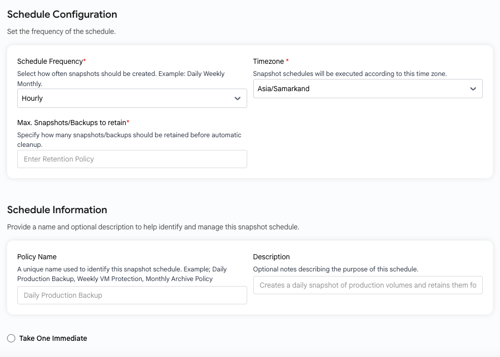

# Расписания

## Расписания резервного копирования и снимков

**Расписания** (Schedules) автоматически создают резервные копии виртуальных машин и снимки томов с заданной периодичностью и удаляют старые копии согласно политике хранения.

---

### Просмотр расписаний

- В меню слева нажмите **Schedules**.
- На странице две вкладки: **Instances Backup Schedules** (резервное копирование ВМ) и **Block Storage Snapshot Schedules** (снимки томов). Для каждой указано количество расписаний, а также сколько из них работает и приостановлено.
- Нажмите **+ Create New**, чтобы создать расписание.

### Создание расписания

- Выберите **проект**, **расположение** и **виртуальную машину** (или том), для которой нужно создавать копии.

> [!NOTE]
> Сейчас резервная копия ВМ сохраняет только корневой том виртуальной машины. Дополнительные подключенные тома в нее не входят.

- В блоке **Schedule Configuration** укажите:
  - **Schedule Frequency** — как часто создавать копии (например, ежечасно, ежедневно, еженедельно или ежемесячно);
  - **Timezone** — часовой пояс, по которому работает расписание (по умолчанию Asia/Samarkand);
  - **Max. Snapshots/Backups to retain** — сколько копий хранить; более старые удаляются автоматически.
- В блоке **Schedule Information** укажите **Policy Name** (название политики) и при желании **Description** (описание).
- Отметьте **Take One Immediate**, чтобы сразу создать первую копию.
- Проверьте **Price Summary** и нажмите **Review & Create**.

> [!TIP]
> **См. также:**
>
> - **[Создание резервных копий](../backups/create-backups.md)**
> - **[Снимок тома](../volume-snapshots/create-volume-snapshot.md)**
