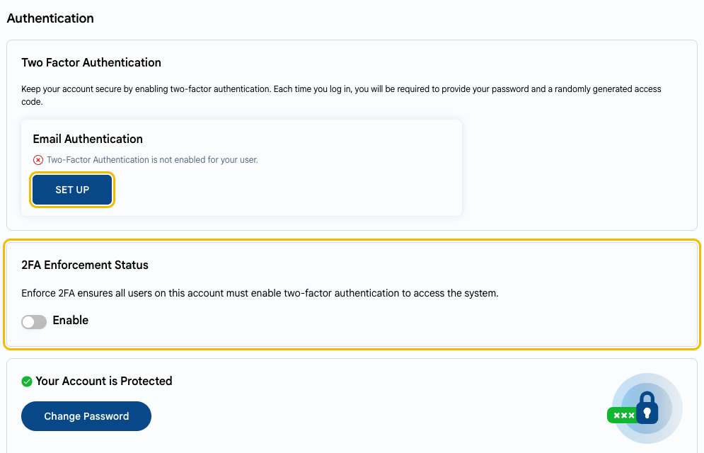
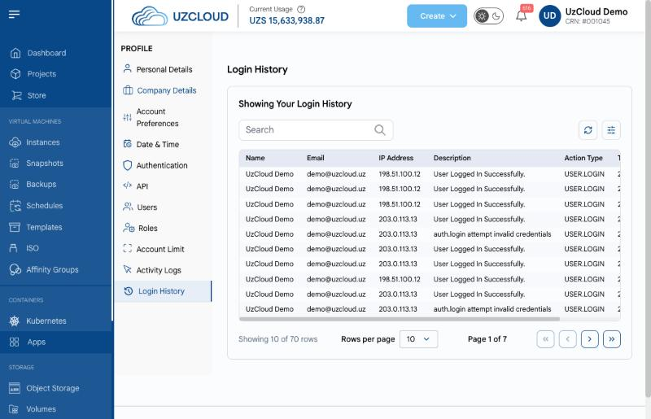

# Безопасность аккаунта

## Защитите аккаунт UzCloud

Тот, кто управляет вашим аккаунтом UzCloud, управляет всеми ВМ, дисками и резервными копиями. Защищайте аккаунт так же внимательно, как серверы.

---

### Включите двухфакторную аутентификацию

Двухфакторная аутентификация (2FA) защищает аккаунт, даже если пароль утек: при каждом входе нужно дополнительно ввести одноразовый код, который приходит на почту.

- Откройте **Profile → Authentication** и нажмите **SET UP** в блоке **Email Authentication**.
- Если вы владелец аккаунта, включите **2FA Enforcement Status**: тогда все пользователи аккаунта должны будут включить двухфакторную аутентификацию, чтобы войти.

См. также **[Настройка профиля](../getting-started/profile-setup.md#двухфакторная-аутентификация)**.

### Используйте сложный уникальный пароль

Используйте длинный пароль, который вы не используете в других сервисах, и храните его в менеджере паролей. Сразу смените пароль, если подозреваете утечку.

### Разделяйте пользователей и роли

- Не используйте один аккаунт на всех сотрудников. Добавьте отдельного пользователя для каждого сотрудника: **Profile → Users**.
- Давайте каждому пользователю только нужную роль. Например, бухгалтеру нужен доступ к биллингу, а не к управлению ВМ.
- Удаляйте пользователей, которым доступ больше не нужен, например после ухода сотрудника.

См. **[Настройка профиля](../getting-started/profile-setup.md#добавление-нового-пользователя)**.

### Храните API-токены и ключи доступа в безопасности

- Не храните API-токены и ключи доступа S3 в репозиториях кода и не пересылайте их в мессенджерах.
- Выдавайте каждому приложению свой ключ, чтобы его можно было отозвать, не затрагивая остальные.
- Регулярно меняйте ключи и сразу отзывайте ключ, который мог утечь. Для объектного хранилища см. **[Управление объектным хранилищем](../object-storage/manage-object-storage.md#просмотр-учетных-данных)**.
- Не делайте бакеты объектного хранилища публичными, если в них не лежат публичные файлы.

### Следите за активностью в аккаунте

Регулярно просматривайте **Activity Logs** и **Login History** в профиле. Незнакомые входы или действия, которые вы не выполняли, — повод сменить пароль и обратиться в поддержку.

---

### Заключение

2FA, отдельные пользователи с минимальными ролями и аккуратное обращение с ключами защищают аккаунт и все ресурсы в нем.

> [!TIP]
> **См. также:**
>
> - **[Чек-лист безопасности](security-checklist.md)**
