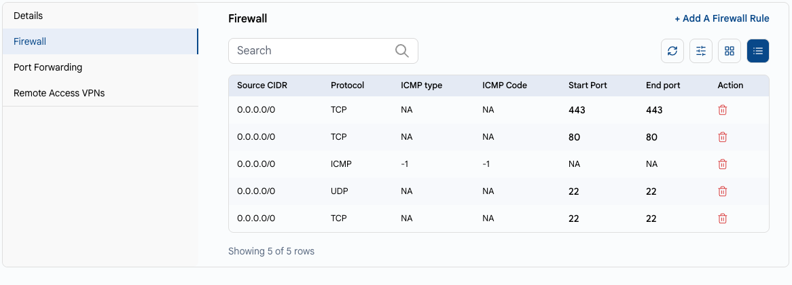
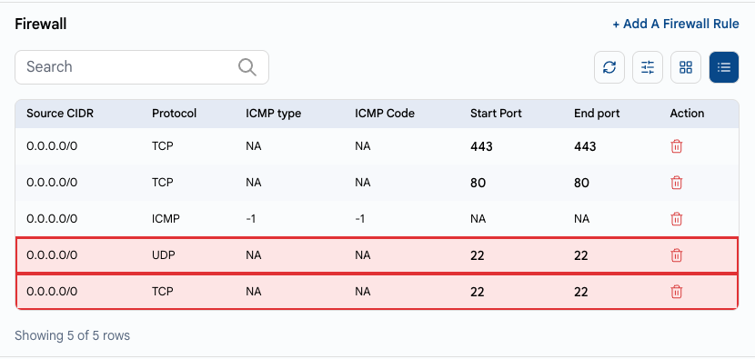
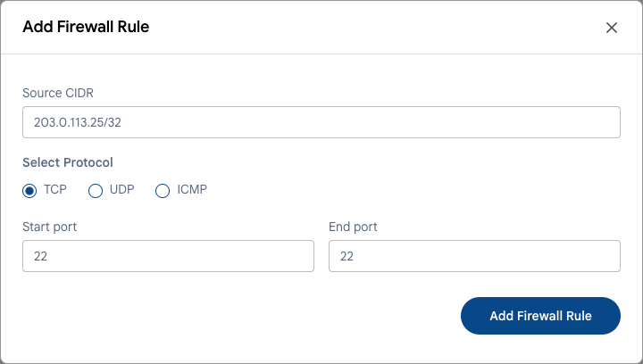

# Сетевой доступ

## Открывайте только то, что нужно

Каждый открытый порт — потенциальная точка входа. База данных, панель администратора или порт удаленного доступа, открытые для всего интернета, сканеры находят за несколько часов.

---

### Правило 1. Открывайте только нужные порты

В UzCloud входящий трафик к публичному IP-адресу управляется **правилами брандмауэра** в консоли. Порт доступен из интернета, только если для него есть правило.

- Откройте публичный IP-адрес ВМ: **Networks → Public IP Address** или вкладку **Firewall** в настройках ВМ. См. **[Публичный IP-адрес](../networks/public-ip-address.md)** и **[Брандмауэр](../compute/vm-settings/firewall.md)**.
- Просмотрите правила и удалите ненужные.
- Открывайте веб-порты (80, 443) для всех, только если ВМ обслуживает публичный сайт.



### Правило 2. Ограничьте удаленный доступ по IP

Не открывайте SSH (22) и RDP (3389) для `0.0.0.0/0`. В примере ниже SSH открыт для всего интернета — именно такие серверы ищут боты:



Удалите такие правила и добавьте правило только для своих адресов. В поле **Source CIDR** укажите только адреса, с которых вы подключаетесь, например IP-адрес офиса с маской `/32`.



Если вы подключаетесь с меняющихся адресов, используйте **VPN удаленного доступа**: включите его на публичном IP-адресе, добавьте пользователей VPN и разрешите SSH/RDP только внутри частной сети. См. **[Публичный IP-адрес](../networks/public-ip-address.md#vpn-удаленного-доступа)** и **[Пользователи VPN](../networks/vpn-users.md)**.

### Правило 3. Не открывайте базы данных и внутренние сервисы

Базы данных (MySQL 3306, PostgreSQL 5432, MongoDB 27017, Redis 6379), панели администратора и мониторинг не должны быть доступны из интернета.

- Размещайте их в частной сети или VPC без публичного проброса портов. См. **[VPC-сеть](../networks/vpc-network/create-vpc-network.md)**.
- Подключайтесь к ним с серверов приложений в той же сети или через VPN.
- Чтобы опубликовать веб-приложение, используйте **[балансировщик нагрузки](../load-balancer/load-balancer.md)**, а не открывайте порты приложения на каждой ВМ.

### Правило 4. Проверьте, что слушает внутри ВМ

Даже если порт закрыт в консоли, лучше не держать запущенными ненужные сервисы. Посмотрите, какие сервисы слушают порты:

```bash
sudo ss -tulpn
```

Остановите и отключите все, что не используете или не узнаете (старые панели, тестовые сервисы):

```bash
sudo systemctl disable --now <сервис>
```

В качестве дополнительного уровня включите брандмауэр ОС: `ufw` в Ubuntu и Debian, `firewalld` в Rocky Linux, AlmaLinux и RHEL.

> [!WARNING]
> Перед включением `ufw` или `firewalld` разрешите в нем SSH (`sudo ufw allow 22/tcp`). Иначе вы потеряете доступ. Если это случилось, воспользуйтесь **[веб-консолью](../compute/console-access.md)**.

### Windows Server и RDP

- Разрешайте RDP только со своих IP-адресов или через VPN.
- Используйте сложные пароли и проверку подлинности на уровне сети (NLA, включена по умолчанию в актуальных версиях Windows Server).
- Регулярно устанавливайте обновления Windows — см. **[Обновление операционной системы](update-os.md)**.

---

### Заключение

Минимальный набор открытых портов и доступ по IP или через VPN заметно уменьшают поверхность атаки ваших ВМ.

> [!TIP]
> **См. также:**
>
> - **[Чек-лист безопасности](security-checklist.md)**
> - **[Защита SSH](ssh-hardening.md)**
