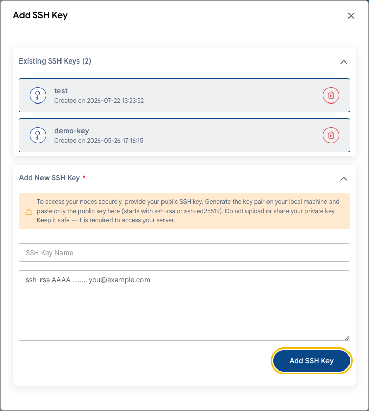

# Защита SSH

## Безопасный доступ к Linux-ВМ по SSH

Подбор паролей по SSH — самая частая атака на серверы с публичным IP-адресом. Боты сканируют интернет и перебирают тысячи паролей в час. Лучшая защита — вход только по SSH-ключам.

---

### Шаг 1. Добавьте SSH-ключ

- При создании ВМ добавьте свой открытый SSH-ключ в блоке **Add SSH Key To Your Instance**. См. **[Виртуальная машина](../compute/compute-instance.md)**.
- Для существующей ВМ ключами можно управлять на вкладке **SSH Keys** в настройках ВМ. См. **[SSH-ключи](../compute/vm-settings/ssh-keys.md)**.



Если ключа еще нет, создайте его на своем компьютере:

```bash
ssh-keygen -t ed25519
```

Открытый ключ сохраняется в `~/.ssh/id_ed25519.pub`. Никогда не передавайте и не загружайте закрытый ключ (`id_ed25519` без `.pub`).

### Шаг 2. Отключите вход по паролю и под root

> [!WARNING]
> Сначала убедитесь, что можете войти по ключу. Не закрывайте текущую SSH-сессию и проверьте вход во втором окне терминала. Иначе можно потерять доступ к серверу. Если это случилось, воспользуйтесь **[веб-консолью](../compute/console-access.md)**.

1. Если вы входите под root, создайте пользователя с правами sudo:

   ```bash
   adduser admin
   usermod -aG sudo admin    # Ubuntu и Debian
   usermod -aG wheel admin   # Rocky, AlmaLinux, RHEL
   ```

   Скопируйте свой ключ этому пользователю (`~/.ssh/authorized_keys`) и проверьте, что можете войти под ним.

2. Откройте конфигурацию SSH-сервера:

   ```bash
   sudo nano /etc/ssh/sshd_config
   ```

3. Задайте параметры:

   ```text
   PasswordAuthentication no
   PermitRootLogin no
   ```

   В новых дистрибутивах проверьте также файлы в `/etc/ssh/sshd_config.d/`: настройка в них может переопределять основной файл.

4. Проверьте конфигурацию и перезапустите SSH-сервер:

   ```bash
   sudo sshd -t && sudo systemctl restart ssh    # Ubuntu и Debian
   sudo sshd -t && sudo systemctl restart sshd   # Rocky, AlmaLinux, RHEL
   ```

5. Во втором окне терминала проверьте, что вход по ключу по-прежнему работает.

### Шаг 3. Ограничьте, кто может подключаться

Разрешите SSH только со своих IP-адресов или через VPN. См. **[Сетевой доступ](network-access.md)**. Смена порта с 22 на нестандартный уменьшает шум от ботов в журналах, но не заменяет ограничение по IP.

### Шаг 4. Блокируйте подбор паролей

Установите **fail2ban** — он блокирует IP-адреса, с которых много раз не удается войти.

```bash
sudo apt install fail2ban                         # Ubuntu и Debian
sudo dnf install epel-release && sudo dnf install fail2ban   # Rocky, AlmaLinux
sudo systemctl enable --now fail2ban
```

Настройки по умолчанию защищают SSH. Проверить статус можно командой:

```bash
sudo fail2ban-client status sshd
```

---

### Заключение

Вход по SSH только по ключам с ограничением по IP защищает ВМ от самых частых атак. Для Windows-ВМ те же принципы относятся к RDP — см. **[Сетевой доступ](network-access.md)**.

> [!TIP]
> **См. также:**
>
> - **[Чек-лист безопасности](security-checklist.md)**
> - **[Подключение по SSH](../compute/connect-with-ssh.md)**
