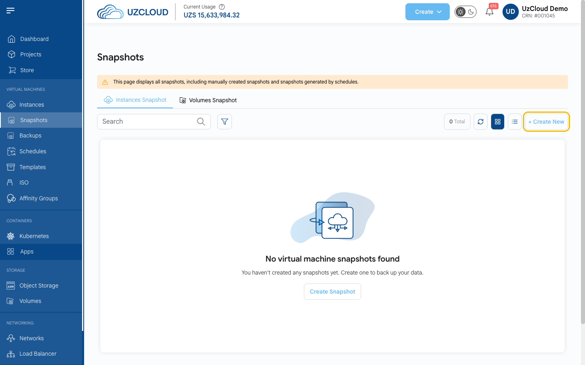

# Обновление операционной системы

## Поддерживайте ОС в актуальном состоянии

Большинство успешных атак используют уязвимости, для которых уже есть исправление. Регулярно устанавливайте обновления и следите, чтобы ваша операционная система еще получала исправления безопасности от производителя.

---

### Шаг 1. Сделайте резервную копию

Перед любым обновлением сделайте снимок ВМ в консоли UzCloud. См. **[Создание снимка ВМ](../vm-snapshots/create-instance-snapshot.md)**.



> [!WARNING]
> Снимок работающей базы данных не всегда согласован. Сохраняйте базы данных и важные конфигурационные файлы отдельно (например, с помощью `pg_dump` или `mysqldump`). Резервная копия надежна только после того, как вы проверили восстановление из нее.

### Шаг 2. Установите обновления

Подключитесь к ВМ по SSH или откройте **[веб-консоль](../compute/console-access.md)** и выполните команду для своего дистрибутива.

**Ubuntu и Debian:**

```bash
sudo apt update && sudo apt upgrade -y
```

**Rocky Linux, AlmaLinux, RHEL, Oracle Linux, CentOS Stream:**

```bash
sudo dnf update -y
```

**SUSE Linux Enterprise / openSUSE:**

```bash
sudo zypper refresh && sudo zypper patch
```

**Windows Server:** откройте **Settings → Windows Update** и нажмите **Check for updates** или выполните `sconfig` и выберите **Install updates**.

### Шаг 3. Перезагрузите ВМ, если это требуется

Если обновились ядро или системные библиотеки, перезагрузите ВМ. **До перезагрузки продолжает работать старое ядро, и уязвимость не закрыта.**

Проверьте, нужна ли перезагрузка:

```bash
# Ubuntu и Debian: файл существует, если нужна перезагрузка
ls /var/run/reboot-required

# Rocky Linux, AlmaLinux, RHEL, Oracle Linux
sudo dnf needs-restarting -r

# SUSE
sudo zypper needs-rebooting
```

Перезагрузите ВМ:

```bash
sudo reboot
```

Перезагрузить ВМ можно и кнопкой **Reboot** на странице ВМ в консоли. После перезагрузки проверьте версию работающего ядра:

```bash
uname -r
```

### Шаг 4. Проверьте, поддерживается ли ваша ОС

Узнайте дистрибутив и его версию:

```bash
cat /etc/os-release
```

Сверьте дату окончания поддержки на сайте производителя. **Следующие версии больше не получают бесплатных обновлений безопасности:**

- CentOS 7 и CentOS 8 (включая CentOS Stream 8);
- Ubuntu 20.04 и более ранние;
- Debian 11 и более ранние;
- Windows Server 2012 R2 и более ранние.

На таких системах `apt upgrade` или `dnf update` не исправляет новые уязвимости. Что делать:

1. **Перейти на поддерживаемую версию (рекомендуется).** Создайте новую ВМ с актуальной ОС (например, Ubuntu 24.04 или 26.04, Debian 12 или 13, Rocky Linux 9 или AlmaLinux 9 — все они доступны в UzCloud), перенесите на нее приложение, данные и настройки, а старую ВМ сохраните на пару недель на случай отката.
2. **Если перенос пока невозможен,** подключите расширенную поддержку от производителя (например, Ubuntu Pro), закройте сервер от интернета и разрешите доступ только через VPN — см. **[Сетевой доступ](network-access.md)**.

> [!NOTE]
> То же касается приложений. Старые версии PHP, Node.js, Python или баз данных (например, PHP 7.x или PostgreSQL 11 и более ранние) не получают исправлений из репозитория дистрибутива, даже если сама ОС поддерживается. Проверяйте и версии приложений.

### Шаг 5. Включите автоматические обновления безопасности

**Ubuntu и Debian:**

```bash
sudo apt install unattended-upgrades
sudo dpkg-reconfigure --priority=low unattended-upgrades
```

**Rocky Linux, AlmaLinux, RHEL, Oracle Linux:**

```bash
sudo dnf install dnf-automatic
sudo systemctl enable --now dnf-automatic-install.timer
```

Автоматические обновления устанавливают исправления, но не перезагружают сервер. Раз в месяц проверяйте, что обновления установились, и перезагружайте ВМ в удобное время.

---

### Заключение

Регулярные обновления и поддерживаемая ОС закрывают большинство известных уязвимостей. Дополните их **[защитой SSH](ssh-hardening.md)** и **[ограничением сетевого доступа](network-access.md)**.

> [!TIP]
> **См. также:**
>
> - **[Чек-лист безопасности](security-checklist.md)**
> - **[CVE-2026-98432: уязвимость TCP в ядре Linux](bulletins/cve-2026-98432.md)**
