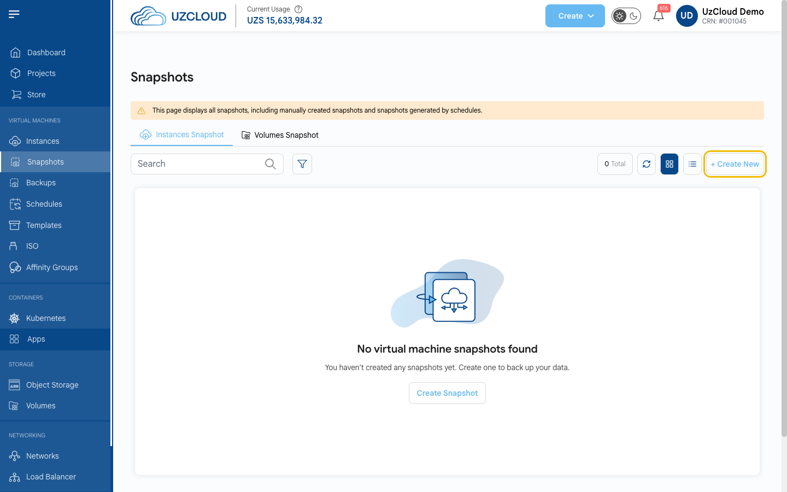
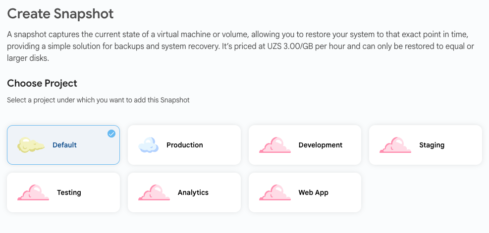
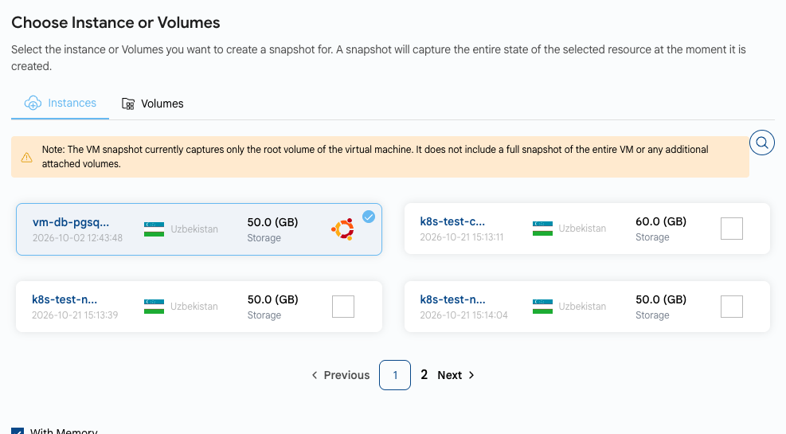
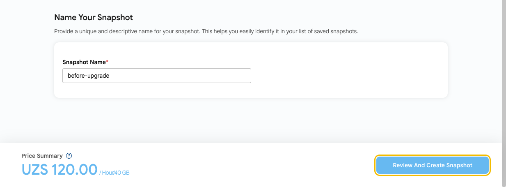

# Создание снимка ВМ

## Снимок виртуальной машины

**Снимок ВМ** фиксирует состояние виртуальной машины на определенный момент времени. К нему можно вернуться после неудачного обновления или случайных изменений.

> [!NOTE]
> Снимки тарифицируются по UZS 3,00 за ГБ в час. Снимок можно восстановить только на диск такого же или большего размера.

---

### Создание снимка ВМ

- В меню слева нажмите **Snapshots** и откройте вкладку **Instances Snapshot**. Здесь отображаются все снимки — созданные вручную и по расписанию.
- Нажмите **+ Create New**. Откроется страница **Create Snapshot**. Снимок также можно сделать кнопкой **VM Snapshot** на странице ВМ.

- Выберите **проект** и **расположение**, в котором находится ВМ.

- В блоке **Choose Instance or Volumes** откройте вкладку **Instances** и выберите виртуальную машину.

> [!IMPORTANT]
> Сейчас снимок ВМ сохраняет только корневой том виртуальной машины. Дополнительные подключенные тома в него не входят — для них делайте снимки томов отдельно.

- Укажите уникальное **Snapshot Name**.
- Проверьте **Price Summary** и нажмите **Review And Create Snapshot**.

### Заключение

Снимки ВМ позволяют быстро вернуть виртуальную машину в рабочее состояние. Чтобы снимки создавались автоматически, используйте **Schedules**. Если нужна помощь, изучите документацию UzCloud или обратитесь в поддержку.

> [!TIP]
> **См. также:**
>
> - **[Снимок тома](../volume-snapshots/create-volume-snapshot.md)**
> - **[Виртуальная машина](../compute/compute-instance.md)**
> - **[Создание резервных копий](../backups/create-backups.md)**
