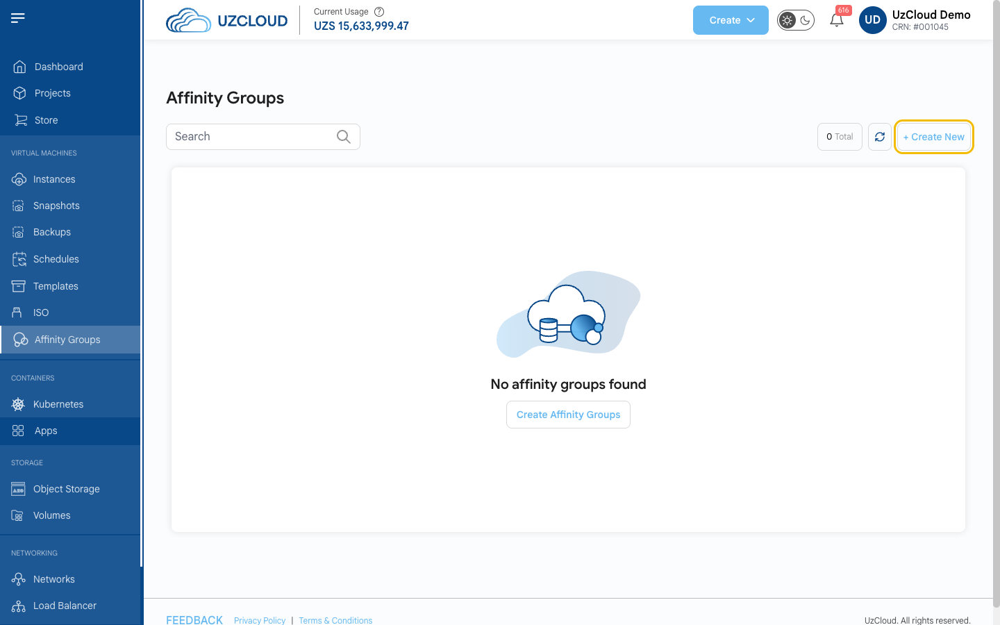
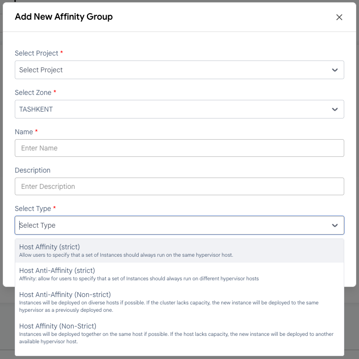

# Affinity guruhlarini yaratish

## UzCloud’da affinity guruhlari (Affinity Groups)

**Affinity guruhlari** (Affinity Groups) ish yuklamalarini (virtual mashinalar, ilovalar yoki xizmatlar) infratuzilmada belgilangan qoidalar asosida joylashtirishni boshqarish imkonini beradi. Ular unumdorlikni optimallashtirish, yuqori mavjudlikni taʼminlash va resurslarni samarali taqsimlashga yordam beradi.

**UzCloud**’da affinity guruhlari virtual mashinalarning (VM) gipervizor xostlarida joylashtirilishini boshqaradi. Ular yordamida VM’lar bitta xostda birga joylashtirilishi yoki turli xostlarga taqsimlanishi qoidalarini belgilash mumkin.

---

### Affinity guruhini yaratish

- Chap menyuda **Affinity Groups** yorligʻini oching.
- Guruh yaratish uchun sahifaning yuqori oʻng burchagidagi **+ Create New** tugmasini bosing. **Add New Affinity Group** oynasi ochiladi.

### Affinity guruhini qoʻshish

- **Select Project** maydonida loyihani va **Select Zone** maydonida zonani tanlang.

- Noyob **Name** (nom) va xohlasangiz **Description** (tavsif) ni kiriting.

- **Select Type** maydonida guruh turini tanlang:

  - **Host Affinity (Strict)** — guruhdagi VM’lar har doim bitta gipervizor xostida ishlashi kerak. Past kechikishli aloqa va umumiy resurslar talab qilinadigan yuklamalar uchun mos. Agar talab bajarilmasa, VM’lar joylashtirilmaydi.
  - **Host Anti-Affinity (Strict)** — VM’lar har doim turli gipervizor xostlarida joylashtirilishi kerak. Bu yagona nosozlik nuqtasini istisno qilib, nosozlikka chidamlilikni oshiradi. Alohida xostlar boʻlmasa, VM’lar joylashtirilmaydi.
  - **Host Anti-Affinity (Non-Strict)** — VM’larni turli xostlarda joylashtirish afzal, lekin majburiy emas. Klasterda resurslar yetishmasa, yangi VM’lar mavjudlari bilan bir xostda joylashtirilishi mumkin.
  - **Host Affinity (Non-Strict)** — VM’larni bitta xostda joylashtirish afzal, lekin kerak boʻlsa boshqa xostlarda ham joylashtirilishi mumkin. Asosiy xostda resurslar yetishmasa, yangi VM’lar mavjud xostda joylashtiriladi.

- **Submit** tugmasini bosing — affinity guruhi yaratiladi.

### Xulosa

Ushbu qoʻllanmaga amal qilib, siz UzCloud’da affinity guruhlarini osongina yaratishingiz va boshqarishingiz mumkin. Affinity guruhlari optimal unumdorlik, yuqori mavjudlik va resurslarni samarali taqsimlashni taʼminlaydigan virtual mashinalarni joylashtirishni boshqarishning kuchli vositasidir. Yordam kerak boʻlsa, UzCloud hujjatlarini oʻrganing yoki qoʻllab-quvvatlash xizmatiga murojaat qiling.
