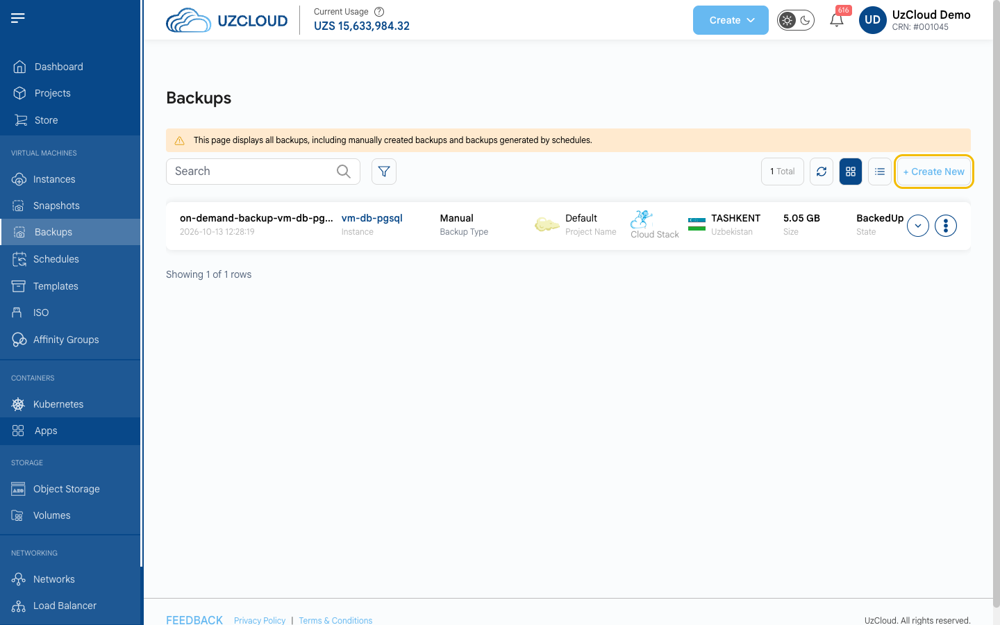
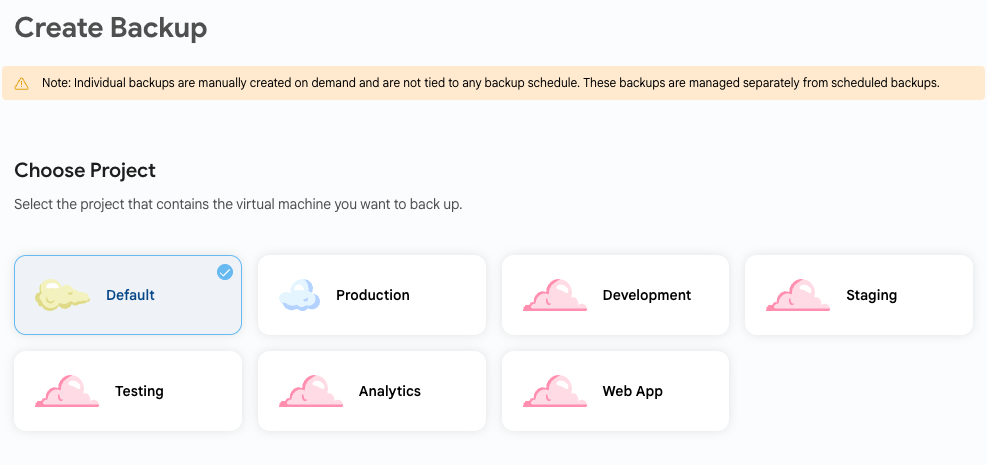
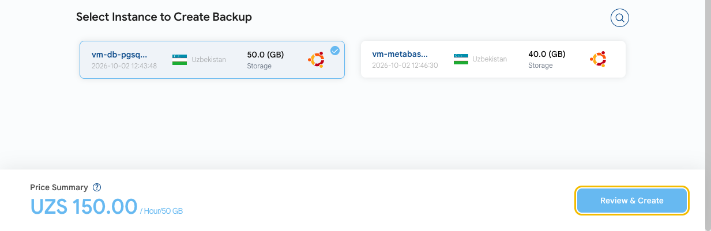

# Zaxira nusxalar yaratish

## Virtual mashinalarning zaxira nusxalari

**Zaxira nusxalar** virtual mashina maʼlumotlarini saqlaydi va ularni tasodifiy oʻchirish, dasturiy nosozliklar va xavfsizlik tahdidlaridan himoya qiladi.

Zaxira nusxani istalgan vaqtda qoʻlda yaratish yoki **Schedules** boʻlimida jadval boʻyicha avtomatik yaratishni sozlash mumkin.

---

### Zaxira nusxalarni koʻrish

- Chap menyuda **Backups** ni bosing. Sahifada barcha zaxira nusxalar — qoʻlda va jadval boʻyicha yaratilganlari koʻrsatiladi: VM, nusxa turi (masalan, **Manual**), loyiha, joylashuv, hajm va holat.
- Zaxira nusxa yaratish uchun **+ Create New** tugmasini bosing.

### Zaxira nusxani qoʻlda yaratish

> [!NOTE]
> Alohida zaxira nusxalar qoʻlda yaratiladi va zaxiralash jadvallariga bogʻlanmagan.

- Virtual mashina joylashgan loyihani tanlang.

- VM joylashuvini tanlang.

- **Select Instance to Create Backup** blokida virtual mashinani tanlang.
- **Price Summary** ni tekshiring (narx diskning har bir GB uchun soatiga hisoblanadi) va **Review & Create** tugmasini bosing.

### Xulosa

Zaxira nusxalar maʼlumotlarni himoya qilish va nosozliklardan keyin tez tiklashning ishonchli usulidir. Yordam kerak boʻlsa, UzCloud hujjatlarini oʻrganing yoki qoʻllab-quvvatlash xizmatiga murojaat qiling.

> [!TIP]
> **Shuningdek qarang:**
>
> - **[VM zaxira nusxalari](../compute/instance-backups.md)**
> - **[VM snapshoti](../vm-snapshots/create-instance-snapshot.md)**
