# Virtual mashina

## UzCloud’da virtual mashinalar

**Virtual mashina** (Compute Instance) — bu bulutdagi virtual server boʻlib, u jismoniy kompyuter kabi ishlaydi. Uning oʻz protsessori, xotirasi va disk maydoni bor, shuning uchun unga dasturlar oʻrnatish, ilovalarni ishga tushirish yoki veb-saytlarni joylashtirish mumkin. Server muhitini toʻliq oʻzingiz boshqarasiz va kerak boʻlganda serverlarni tezda ishga tushirib, masshtablashingiz mumkin.

---

### UzCloud’da virtual mashina yaratish

- Chap menyuda **Instances** ni bosing. Sahifada barcha virtual mashinalaringiz koʻrsatiladi: holati, joylashuvi, loyihasi, operatsion tizimi, IP manzili va konfiguratsiyasi.
- Yuqori oʻng burchakdagi **+ Create New** tugmasini bosing. **Create a Server** sahifasi ochiladi.

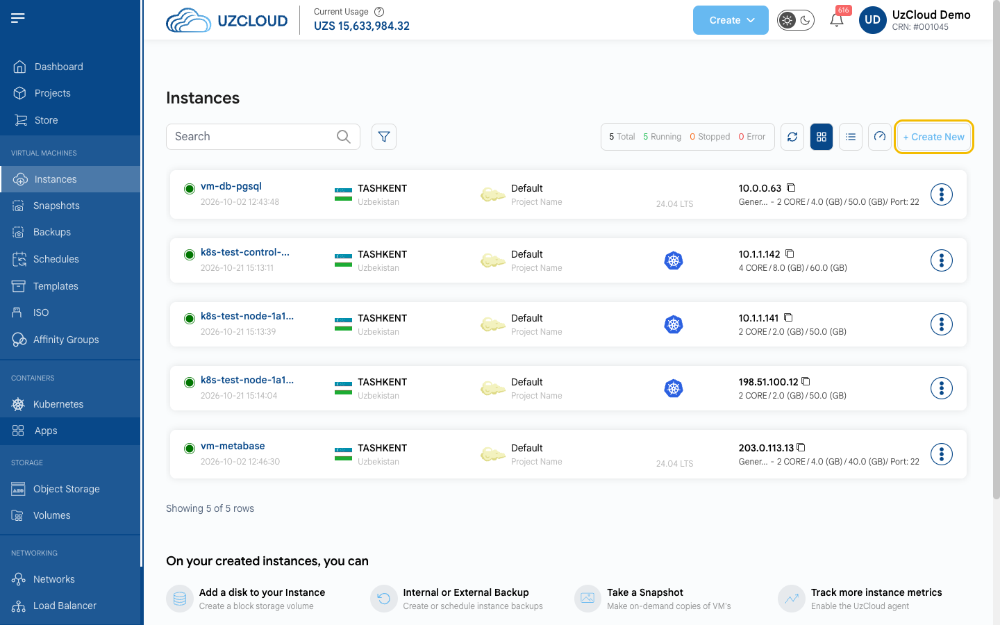

### Loyihani tanlash

- Resurslarni qulay tartibga solish va boshqarish uchun serverni loyihalaringizdan biriga biriktiring.

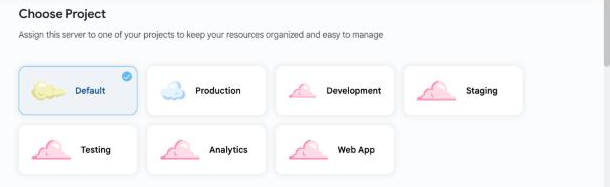

### Joylashuvni tanlash

- Server joylashadigan maʼlumotlar markazini tanlang: **TASHKENT** yoki **FERGANA**.

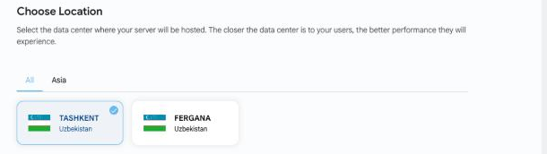

### Obrazni tanlash

- Serverga oʻrnatiladigan operatsion tizim yoki ilovani tanlang. Obrazlar yorliqlar boʻyicha guruhlangan:
  - **Linux** — Ubuntu, CentOS, Debian, Rocky Linux, AlmaLinux, SUSE va boshqa distributivlar, shuningdek tarmoq va telefoniya obrazlari (masalan, MikroTik CHR, OPNsense, FreePBX).
  - **Windows** — Windows Server 2019, 2022 va 2025.
  - **Marketplace Apps** — tayyor ilovalar toʻplamlari, masalan WordPress, GitLab Runner, Zabbix, Prometheus-Grafana, n8n, Jitsi Meet.
- Obraz kartochkasidagi ochiluvchi roʻyxatdan versiyani tanlang.

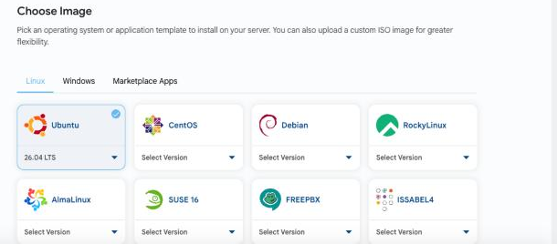

### Tarif rejasini tanlash

- **Compute Offering** blokida kerakli vCPU soni va xotira hajmiga qarab reja tanlang. Rejalar **General Compute** va **GPU Compute** yorliqlari boʻyicha guruhlangan; har biri uchun oylik va soatlik narx koʻrsatilgan.
- Oʻz konfiguratsiyangizni belgilash uchun **Custom Plan** qatorida vCPU soni va xotira hajmini kiriting.

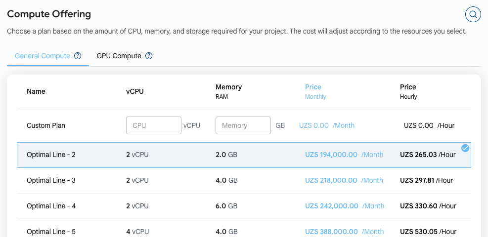

### Tizim diskini tanlash

- **OS Disk Offering** blokida disk turini (**SSD**, **HDD** yoki **NVMe**) va disk variantini tanlang. Tayyor hajmni tanlash yoki oʻz hajmingizni GB’da kiritish mumkin.

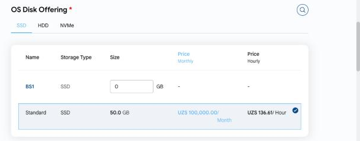

### Tarmoqni tanlash

- **Isolated Network** — tanlangan joylashuvda server uchun yangi izolyatsiya qilingan tarmoq yaratadi.
- **VPC Network** — trafik marshrutlash, VPN shlyuzi va site-to-site VPN ulanishlari ustidan toʻliq nazoratga ega yangi VPC yaratadi.
- Serverni mavjud tarmoqqa ulash uchun uni quyidagi roʻyxatdan tanlang. Umumiy tarmoqlardagi (masalan, **Internet**) IP manzillar uchun qoʻshimcha toʻlov olinadi.

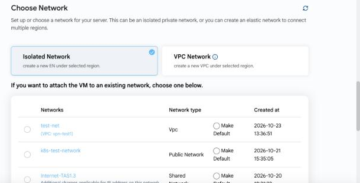

- **Public IP Address** blokida serverga internetdan kirish uchun ommaviy IPv4 manzil kerakligini belgilang (standart holatda yoqilgan).

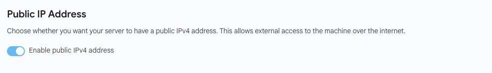

### Affinity guruhlari (ixtiyoriy)

- VM’larning gipervizor xostlarida joylashtirilishini boshqarish uchun affinity guruhini tanlang yoki **+ Create Affinity Groups** orqali yangisini yarating.

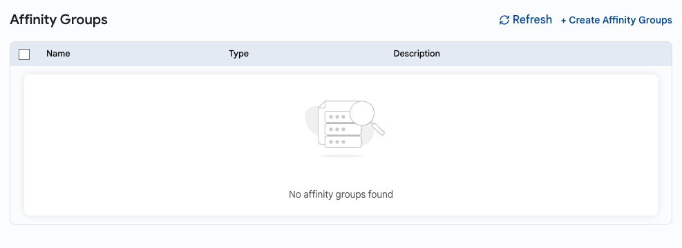

### Server sozlamalari

- Serverga SSH kalit orqali ulanish uchun **Add SSH Key To Your Instance** yonidagi **Add now** ni bosing.
- **Eslatma**: baʼzi OT obrazlari, masalan Arch Linux uchun SSH kalit majburiy, chunki parol orqali kirish qoʻllab-quvvatlanmaydi.

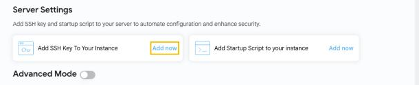

- Mavjud kalitlardan birini tanlang yoki nom kiriting va ommaviy kalitni joylashtiring (`ssh-rsa` yoki `ssh-ed25519` bilan boshlanadi), soʻng **Add SSH Key** tugmasini bosing. Hech qachon maxfiy kalitni yuklamang.

- Server birinchi marta ishga tushganda buyruqlar avtomatik bajarilishi uchun **Add Startup Script to your instance** yonidagi **Add now** ni bosing, skriptni kiriting va **Add Startup Script** tugmasini bosing.

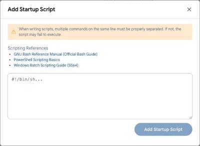

### Kengaytirilgan sozlamalar (ixtiyoriy)

- Qoʻshimcha parametrlarni sozlash uchun **Advanced Mode** ni yoqing:
  - **Boot Mode** — Legacy yoki Secure boot.
  - **Boot Type** — UEFI yoki BIOS.
  - **Dynamic Scaling Enable** — server resurslarini uni toʻxtatmasdan oʻzgartirish imkonini beradi.

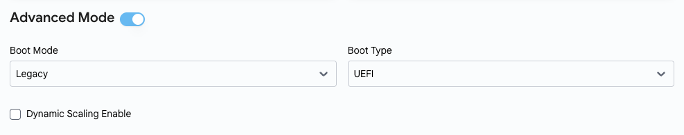

- **Select Addons** blokida serverga qoʻshimcha xizmatlarni ulash mumkin, masalan **Antivirus**.

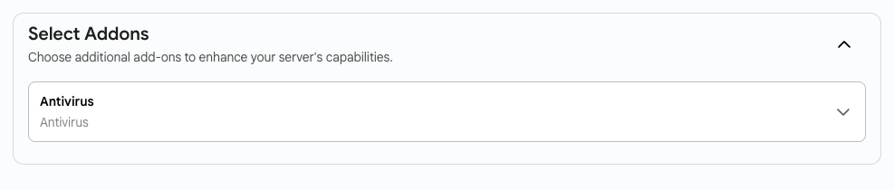

### Server nomi

- **Server Name** (server nomi) va **Server Hostname** (xost nomi) avtomatik belgilanadi. Serverni boshqaruv panelida oson topish uchun ularni oʻzgartiring.

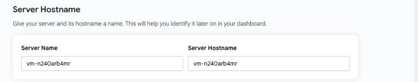

### Tekshirish va joylashtirish

- Sahifaning pastki qismida **Billing Cycle** (toʻlov davri) ni tanlang: **Monthly** (oylik) yoki **Yearly** (yillik). **Price Summary** da tanlangan konfiguratsiya narxi koʻrsatiladi.
- Konfiguratsiyani tekshiring va virtual mashinani yaratish uchun **Review & Deploy** tugmasini bosing.

---

### Xulosa

UzCloud’da virtual mashina yaratish — kerakli moslashuvchanlik va masshtablanuvchanlikni taʼminlaydigan oddiy jarayon. Resurslardan samarali foydalanish uchun sozlamalarni muntazam koʻrib chiqing va optimallashtiring. Yordam kerak boʻlsa, UzCloud hujjatlarini oʻrganing yoki qoʻllab-quvvatlash xizmatiga murojaat qiling.

> [!TIP]
> **Shuningdek qarang:**
>
> - **[Virtual mashina sharhi](instance-overview.md)**
> - **[VM zaxira nusxalari](instance-backups.md)**
> - **[VM faoliyat jurnali](vm-activity-logs.md)**
