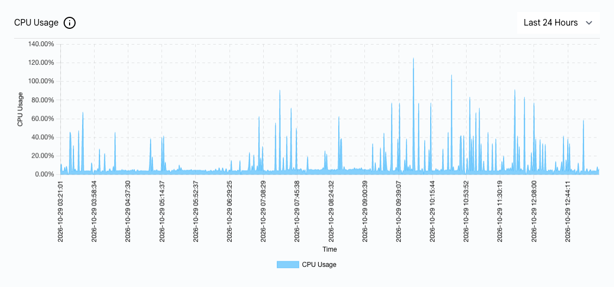
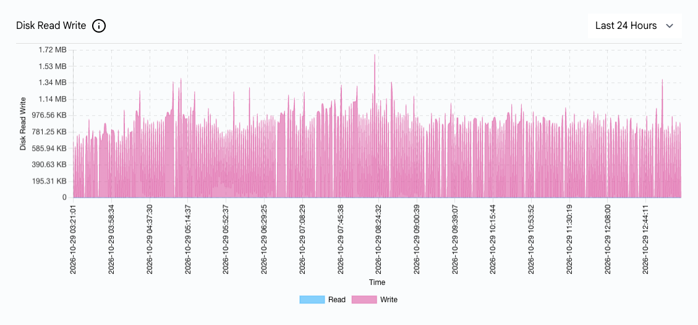
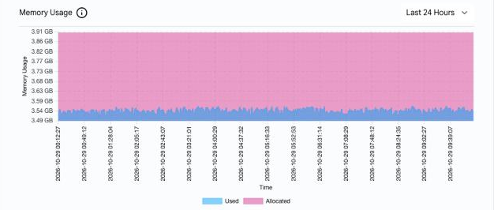
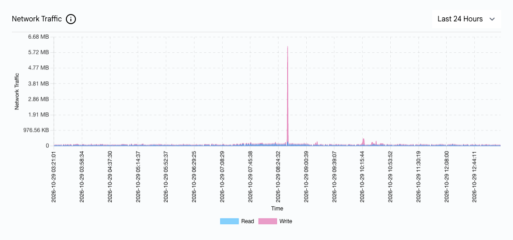
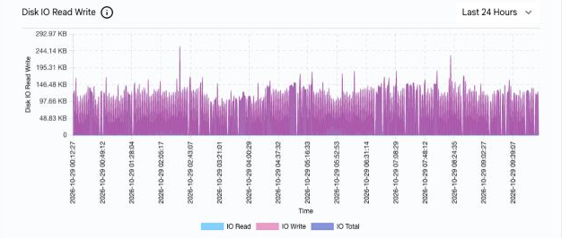

# Resurslar monitoringi

## UzCloud’da resurslar monitoringi

UzCloud har bir virtual mashinaning resurslardan foydalanishini grafiklar yordamida kuzatish imkonini beradi. Ular yordamida unumdorlikni baholash, tor joylarni topish va resurslarni rejalashtirish mumkin.

- **Instances** sahifasida **Virtual Machine Overview** sahifasini ochish uchun VM nomini bosing.
- **Usage Graphics** yorligʻiga oʻting.
- Har bir grafik uchun uning yuqori oʻng burchagidagi ochiluvchi roʻyxatda davrni tanlang: **Last 24 Hours**, **Last 12 Hours**, **Last 6 Hours** yoki **Last 1 Hour**.

### CPU yuklamasi

**CPU Usage** grafigi tanlangan davrdagi protsessor yuklamasini koʻrsatadi. U yordamida yuklama choʻqqilarini aniqlash va VM’ga kuchliroq reja kerakligini hal qilish mumkin.

### Diskdan oʻqish va diskka yozish

**Disk Read Write** grafigi diskdan oʻqilgan va diskka yozilgan maʼlumotlar hajmini koʻrsatadi. U disk unumdorligini tahlil qilish va xotiradagi tor joylarni topishga yordam beradi.

### Xotiradan foydalanish

**Memory Usage** grafigi foydalanilayotgan xotirani ajratilgan xotira bilan taqqoslab koʻrsatadi. U yordamida xotira isteʼmolini kuzatish va ehtimoliy xotira sizib chiqishlarini payqash mumkin.

### Tarmoq trafigi

**Network Traffic** grafigi tarmoq orqali uzatilgan maʼlumotlar hajmini koʻrsatadi. Undan tarmoq yuklamasini kuzatish, trafik qonuniyatlarini aniqlash va tarmoq muammolarini tashxislash uchun foydalaning.

### Disk kiritish-chiqarish amallari

**Disk IO Read Write** grafigi diskning kiritish-chiqarish amallari sonini koʻrsatadi: oʻqish, yozish va umumiy soni.

### Xulosa

Ushbu grafiklar yordamida siz virtual mashinalar unumdorligini real vaqtda kuzatishingiz, muammolarni oldindan bartaraf etishingiz va resurslardan foydalanishni optimallashtirishingiz mumkin. Yordam kerak boʻlsa, UzCloud hujjatlarini oʻrganing yoki qoʻllab-quvvatlash xizmatiga murojaat qiling.
