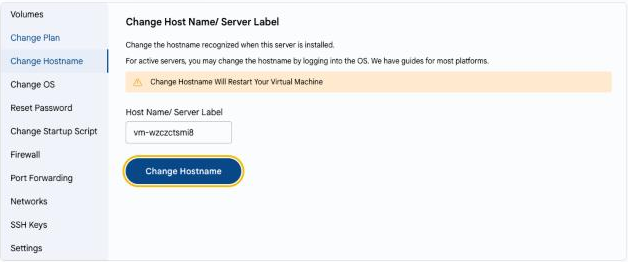

# Xost nomini oʻzgartirish

## Xost nomi sozlamalari

Xost nomi — virtual mashinaning tarmoqdagi nomi. Uni nomlash qoidalaringizga muvofiq oʻzgartirish mumkin.

---

- **VM Settings** yorligʻida **Change Hostname** ni tanlang.
- **Host Name/ Server Label** maydoniga yangi nomni kiriting va **Change Hostname** tugmasini bosing.
- Shu tarzda server oʻrnatilganda foydalaniladigan xost nomi oʻzgartiriladi. Ishlab turgan serverda xost nomini operatsion tizimga kirib ham oʻzgartirish mumkin.

> [!WARNING]
> Xost nomini oʻzgartirish virtual mashinani qayta ishga tushiradi.

---

### Xulosa

Serverlarni osonroq topish va domen xizmatlari bilan integratsiya qilish uchun tushunarli va bir xil xost nomlaridan foydalaning.
