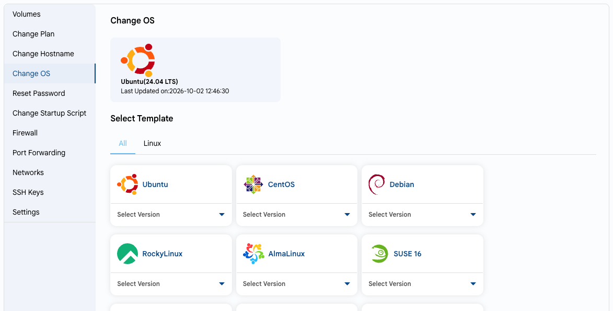

# OT’ni oʻzgartirish

## Operatsion tizimni oʻzgartirish

Ushbu sozlama virtual mashinaning operatsion tizimini qayta oʻrnatish yoki boshqasiga almashtirish imkonini beradi.

---

- **VM Settings** yorligʻida **Change OS** ni tanlang. Yuqorida joriy OT va oxirgi oʻzgartirish sanasi koʻrsatiladi.
- **Select Template** blokida OT va uning versiyasini tanlang, soʻng **Change OS** tugmasini bosing.

> [!WARNING]
> Operatsion tizimni oʻzgartirish serverdagi barcha maʼlumotlarni oʻchiradi. OT’ni oʻzgartirishdan oldin snapshotlar va zaxira nusxalarni oʻchiring.

---

### Xulosa

OT’ni oʻzgartirish toza muhit bilan ishni boshlash imkonini beradi. Bu amaldan oldin har doim muhim maʼlumotlarning zaxira nusxasini oling.

> [!TIP]
> **Shuningdek qarang:**
>
> - **[Shablon yaratish](../../templates/create-templates.md)**
> - **[ISO import qilish](../../isos/import-iso.md)**
